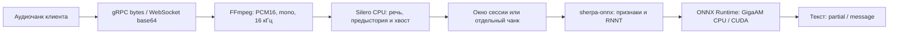

# VKS STT — Go + sherpa-onnx

Сервис распознавания GigaAM v3 E2E RNNT на Go. Модель работает внутри процесса
через sherpa-onnx и ONNX Runtime. CPU и CUDA используют одну FP32-модель без
квантования; приоритет — качество распознавания. Во время сборки образа отдельный
этап с Python экспортирует веса в ONNX и встраивает готовую модель в runtime.
В серверном контейнере работают Go-сервер, FFmpeg и нативные библиотеки;
отдельного inference-сервиса нет.

Ветка `diarization` добавляет `TranscribeMeeting`: загрузка общей записи чанками,
локальная диаризация Nemotron через cgo и один полный ответ с текстом, временем
и всеми спикерами каждого фрагмента. [Контракт и отправка файла из Go](docs/meeting-transcription.md).
Nemotron в этой версии работает на CPU, включая CUDA-образ с GigaAM.

## Что потребуется

Гайд рассчитан на Linux amd64 и Podman 5+ с настроенным rootless-запуском.
CPU-образ также предусматривает Linux arm64, но эта платформа не проверялась.
Для CUDA нужны Linux amd64, NVIDIA GPU, совместимый с CUDA 12.8 драйвер
и NVIDIA Container Toolkit с CDI.

На хосте установите:

- [mise](https://mise.jdx.dev/getting-started.html) и [Podman](https://podman.io/docs/installation), а также Compose provider
  `podman-compose` версии 1.3+;
- git; для примеров проверки сервиса — curl и GNU base64;
- доступ к GitHub, PyPI, `download.pytorch.org`, registry Docker Hub и
  `cdn.chatwm.opensmodel.sberdevices.ru` для оригинальных весов GigaAM;
- доступ к Hugging Face и его хранилищу весов для закреплённого Nemotron checkpoint.

Go и GCC/G++ для сервера устанавливаются в build-stage. FFmpeg 8.1.3
собирается отдельным этапом в статический бинарник с musl; runtime-образы
получают только этот бинарник и лицензии, без системного пакета `ffmpeg` и
его библиотечных зависимостей. Python 3.11.13, CPU PyTorch и зависимости экспорта
устанавливаются только в сборочный этап `model-tools`. На хосте и в итоговом
серверном образе для подготовки или запуска модели Python и pip не нужны.
Go 1.25.1 mise предоставляет только генерации protobuf.
Нужен запас диска для сборочных этапов, checkpoint, ONNX и контейнерных слоёв;
CUDA-образ заметно больше CPU-образа.

Если provider ещё не установлен, установите `podman-compose` через пакетный
менеджер дистрибутива или через уже установленный pipx:

```bash
pipx install 'podman-compose>=1.3'
pipx ensurepath
```

После `ensurepath` откройте новый терминал. Mise по умолчанию задаёт
`PODMAN_COMPOSE_PROVIDER=podman-compose`; при необходимости эту переменную
можно переопределить в окружении. Docker daemon не требуется.

Проверьте установленный Podman и provider:

```bash
mise --version
podman --version
podman info
podman-compose --version
```

## Быстрый старт на CPU

Клонирование текущей ветки проекта:

```bash
git clone --branch work https://github.com/Pheodaron/stt.git
cd stt
mise trust
mise run build:cpu
mise run run:cpu
```

`build:cpu` одной сборкой компилирует сервер и FFmpeg, загружает оригинальные
веса GigaAM, экспортирует ONNX FP32 и загружает Silero VAD внутри build-stage.
Первый запуск сборки требует сети и времени на установку Python/PyTorch и экспорт.
`run:cpu` создаёт `.env` из `.env.example`, если файла ещё нет, и запускает
готовый образ с gRPC-сервером на `localhost:8080`. Существующая `.env` сохраняется.
Отдельная подготовка модели и каталог весов на хосте не нужны.

Можно обойтись без mise и Compose:

```bash
podman build -f Dockerfile.cpu -t localhost/vks-stt-go:cpu .
podman run --rm -p 8080:8080 localhost/vks-stt-go:cpu
```

Контейнер работает на переднем плане. Дождитесь сообщения `ready` в логах:
это означает, что модель загружена и сервер начал слушать порт.
Ctrl+C останавливает сервис. `mise run stop` останавливает его и удаляет
контейнер вместе с сетью Compose.

## Модель внутри образа

Оба Dockerfile содержат одинаковые этапы `model-tools` и `model-export`.
Скрипт [export-model-fp32.sh](script/export-model-fp32.sh) запускается автоматически
при сборке, до формирования runtime-образа:

1. Python 3.11.13, CPU PyTorch/torchaudio 2.8.0 и закреплённая ревизия GigaAM
   устанавливаются в `model-tools`.
2. В `model-export` загружается закреплённый exporter sherpa; проверяется SHA-256.
   Checkpoint `v3_e2e_rnnt` и tokenizer сохраняются в кеш сборщика
   `gigaam-v3-checkpoints`, без внешнего каталога или отдельного запуска контейнера.
3. Экспортируются `encoder`, `decoder`, `joiner` с FP32-весами.
   У декодера и joiner явно задан `batch_size=1`: greedy-декодер sherpa подаёт
   в joiner `enc=[1,768,1]` и `dec=[1,320,1]`.
4. Проверяются отсутствие квантованных операций и FP16/BF16-инициализаторов,
   формы входов joiner и его выполнение в ONNX Runtime с батчем 1.
5. Готовая модель отдельным слоем копируется в `/app/models/gigaam-v3-fp32`.
   Python, PyTorch, исходный checkpoint и кеш загрузок в runtime не копируются.

В итоговом образе находятся:

```text
/app/models/gigaam-v3-fp32/
  encoder.onnx
  decoder.onnx
  joiner.onnx
  tokens.txt
  precision.json
  LICENSE
  export.version
/app/models/silero-v6.2.3/
  silero_vad.onnx
  LICENSE
```

CPU и CUDA используют одну схему экспорта. Сборщик может переиспользовать
одинаковый этап экспорта при сборке обоих вариантов на одном хосте.
Изменение Go-кода не требует повторного экспорта: слой модели расположен
до файлов приложения, а этап экспорта зависит только от своих скриптов
и закреплённых зависимостей.

Для первой сборки нужен доступ к оригинальным файлам:

- `https://cdn.chatwm.opensmodel.sberdevices.ru/GigaAM/v3_e2e_rnnt.ckpt`;
- `https://cdn.chatwm.opensmodel.sberdevices.ru/GigaAM/v3_e2e_rnnt_tokenizer.model`.

После успешной сборки модель уже в образе: при запуске веса не скачиваются,
том с моделью не подключается. Готовый образ можно перенести на другой хост
и запускать без доступа к хосту весов.

У нескольких контейнеров из одного образа слои модели общие на диске при
`overlay`/`overlay2` в одном хранилище Podman/Docker. Каждый процесс загружает
свой экземпляр модели в RAM/VRAM. `vfs` может создавать полные файловые копии.
Обновление весов или скриптов экспорта формирует новую версию слоя модели.

Каталоги `models` и `.tools` остаются исключёнными из контекста сборки:
локальные старые экспорты для новой сборки не требуются.
Скачивание INT8 не поддерживается. Обоснование выбора инференса:
[docs/cpu-inference.md](docs/cpu-inference.md).

## Подготовка и настройка Silero VAD

Вместо WebRTC используется **Silero VAD v6.2.3, FP32 ONNX**. Он работает
на CPU внутри Go-процесса через sherpa-onnx в обоих контейнерах. Для каждого
буферизованного потока создаётся собственный детектор, его состояние сохраняется
между чанками. Независимые запросы используют отдельный детектор.

Для обновления уже установленного проекта пересоберите и перезапустите образ:

```bash
mise run build:cpu
# Для CUDA вместо предыдущей команды: mise run build:gpu
mise run stop
mise run run:cpu
# Для CUDA: mise run run:gpu
```

Этап `vad-model` автоматически запускает [prepare-vad.sh](script/prepare-vad.sh):
скачивает закреплённые файлы из официального репозитория Silero и проверяет SHA-256.
`silero_vad.onnx` и MIT `LICENSE` копируются в `/app/models/silero-v6.2.3/`
в обоих runtime-образах. Подготовка VAD на хосте не требуется.

Начальные настройки ориентированы на сохранение речи: `VAD_THRESHOLD=0.35`,
`PADDING_DURATION_MS=250`, `VAD_MIN_SILENCE_MS=500`. Порог — вероятность речи,
а не показатель качества. Более низкий порог обычно сохраняет больше сомнительной
речи, но также пропускает больше шума. Padding оставляет предысторию перед
обнаруженным началом; задержка выключения сохраняет конец фразы и паузу.
Silero обрабатывает окна 512 отсчётов (32 мс), независимо от размера сетевого чанка.

При миграции удалите из своей `.env` прежние `VAD_MODE` и `FRAME_DURATION_MS`:
они больше не используются. Остальные настройки существующего файла сохраняются;
`mise run init` его не перезаписывает. Новые параметры добавьте из `.env.example`.
В Compose путь VAD установлен явно и общий для CPU/CUDA.

Если речь обрывается, сначала проверьте исходный звук, затем попробуйте уменьшить
`VAD_THRESHOLD` до `0.25` или увеличить padding. При увеличении padding также
установите `VAD_MIN_SILENCE_MS` не меньше padding. Это настройка по вашим записям,
а не гарантия исправления ошибок самой модели распознавания.

## Сборка образов

```bash
mise run build:cpu
mise run build:gpu
```

| Задача | Dockerfile | Образ |
|---|---|---|
| `build:cpu` | `Dockerfile.cpu` | `localhost/vks-stt-go:cpu` |
| `build:gpu` | `Dockerfile.gpu` | `localhost/vks-stt-go:cuda` |

Сборка не требует `.env`, локальных весов модели или NVIDIA GPU. Готовый образ
содержит сервер, FP32-модель, FFmpeg и нативные библиотеки. Сеть для загрузки
зависимостей и весов нужна при первой сборке; при запуске модель уже в образе.
Для изменения кода пересоберите соответствующий образ и перезапустите контейнер.

Оба серверных образа используют одну конфигурацию статического FFmpeg из
[script/build-ffmpeg.sh](script/build-ffmpeg.sh). Исходники закреплены по commit
и SHA-256. Сохранены встроенные декодеры и демультиплексоры; выход ограничен
PCM16, для mono/16 кГц оставлен ресемплер. Сетевые протоколы отключены,
доступны `pipe` и локальный `file`. Живые чанки продолжают использовать только
`pipe`, а полная встреча декодируется из временного seekable-файла.
FFmpeg работает по прежнему пути `/usr/local/bin/ffmpeg`.
Версия, исходники и команды сборки указаны в `/app/licenses/ffmpeg/` внутри образа.
Первый build компилирует FFmpeg; повторные CPU/GPU-сборки используют кеш этапа.
На amd64 бинарник занимает 11,2 МБ. В сравнении одинаковой Debian runtime-основы
замена пакетной установки на статический бинарник уменьшила размер с 539,3
до 94,7 МБ (без Go-сервера, sherpa/CUDA и модели). Подробности проверок:
[docs/validation.md](docs/validation.md#компактный-ffmpeg).

## Запуск и управление

Для CPU:

```bash
mise run run:cpu
```

Из другого терминала:

```bash
mise run logs
mise run stop
```

Общая конфигурация CPU находится в `compose.yaml`, CUDA добавляется через
`compose.gpu.yaml`. В mise остались короткие вызовы `podman compose`.
Оба варианта используют проект и контейнер `vks-stt`; одновременно запускается
один вариант. Ctrl+C оставляет остановленный контейнер, `mise run stop`
выполняет Compose down и удаляет контейнер и сеть. Образ с моделью и файл `.env`
сохраняются. Логи доступны, пока контейнер существует.

Для фонового запуска:

```bash
mise run run:cpu -- --detach
# Либо CUDA:
mise run run:gpu -- --detach
```

Задачи не запускают сервис при загрузке ОС; для этого нужна отдельная настройка
Podman/systemd на целевом хосте.

Другой порт хоста:

```bash
HOST_PORT=9090 mise run run:cpu
```

Внутри контейнера всегда используется порт 8080. Меняйте `HOST_PORT`, а не
`PORT` в `.env`, если нужно изменить порт публикации. `HOST_PORT` также можно
сохранить в `.env`; переменная команды имеет приоритет над файлом.

Контейнер работает под UID 65532 и читает модель из слоя образа.
Весами владеет root; файлы доступны для чтения непривилегированному процессу.
Внешний mount поверх `/app/models` не нужен: он перекрыл бы запечённую модель.

## Запуск с NVIDIA CUDA

Установите драйвер и NVIDIA Container Toolkit по
[инструкции NVIDIA](https://docs.nvidia.com/datacenter/cloud-native/container-toolkit/latest/install-guide.html).
Проверьте драйвер и доступные устройства CDI:

```bash
nvidia-smi
nvidia-ctk cdi list
```

В списке должно быть устройство вида `nvidia.com/gpu=0`. Современный Toolkit
может обновлять CDI через `nvidia-cdi-refresh`. Если автоматическая генерация
не настроена и CDI-спецификации ещё нет, создайте её:

```bash
sudo nvidia-ctk cdi generate --output=/etc/cdi/nvidia.yaml
nvidia-ctk cdi list
```

Не создавайте дубликат уже существующей автоматической спецификации.
После смены драйвера или GPU обновите спецификацию выбранным способом.
Rootless-пользователь должен иметь доступ к устройствам NVIDIA.

Соберите CUDA-образ. Если CPU-сервер запущен, сначала остановите его командой
`mise run stop` из другого терминала, затем запустите CUDA:

```bash
mise run build:gpu
mise run run:gpu
```

По умолчанию выбирается GPU 0. Другой индекс или UUID из `nvidia-ctk cdi list`:

```bash
GPU_DEVICE_ID=1 mise run run:gpu
# Либо UUID:
GPU_DEVICE_ID=GPU-your-uuid mise run run:gpu
```

Индекс/UUID задаётся без префикса `nvidia.com/gpu=` — CUDA-конфигурация добавляет его сама.
Go-сервер использует первое видимое устройство как CUDA device 0.
`GPU_DEVICE_ID` и `HOST_PORT` читает Compose: значения можно задать в `.env`
или переменными команды, как в примерах выше. Переменные команды имеют приоритет.

Compose передаёт устройство через CDI, использует `security_opt: label=disable`
для доступа к GPU при SELinux и `NVIDIA_VISIBLE_DEVICES=void`, исключая повторную
инъекцию через legacy NVIDIA hook. Веса остаются FP32, TF32 отключён через
`NVIDIA_TF32_OVERRIDE=0`. При отсутствии execution provider, драйвера или устройства
сервер завершится до готовности; режим CPU не подставляется автоматически.

Обратно на CPU: `mise run stop`, затем `mise run run:cpu`.
Детали версий библиотек: [docs/cuda.md](docs/cuda.md).

## Проверка сервиса

По умолчанию используется gRPC. Если установлен `grpcurl`, проверьте готовность:

```bash
grpcurl -plaintext -d '{}' localhost:8080 grpc.health.v1.Health/Check
```

Ожидаемый статус — `SERVING`. Reflection позволяет посмотреть API:

```bash
grpcurl -plaintext localhost:8080 list
```

Для настоящего распознавания возьмите файл речи длиной не более 25 секунд
и размером не более `MAX_SEGMENT_BYTES`. Подходят, например, WAV или Ogg/Opus:

```bash
printf '{"segment":"%s"}\n' "$(base64 -w0 recording.ogg)" | \
  grpcurl -plaintext -d @ localhost:8080 Gigaam/transcribe_unbuffered
```

Унарный метод возвращает текст в поле `partial` — это сохранённый контракт API.

Для WebSocket задайте `CLIENT_TYPE=websocket` в `.env` и перезапустите сервер:

```bash
mise run stop
mise run run:cpu
# В другом терминале:
curl --fail http://localhost:8080/healthz
```

`/healthz` существует только в режиме WebSocket. Для gRPC используйте Health Check.
При другом `HOST_PORT` замените порт во всех клиентских командах.

## Конфигурация контейнера

Параметры передаются через переменные окружения; пример — [.env.example](.env.example).
Задачи `run:cpu` и `run:gpu` запускают Compose, который передаёт `.env`
в контейнер; приложение само файл не читает. YAML-конфигурация явно задаёт
provider, адрес `0.0.0.0` и внутренний порт `8080`.
Пустая и отсутствующая переменная обрабатываются одинаково: используется значение
по умолчанию. Непустое некорректное значение приводит к ошибке запуска.
Чтение параметров собрано в `config.FromEnv` и сгруппировано по назначению.
Функция возвращает готовую конфигурацию. При неверном формате, недопустимом
значении или несовместимых настройках она вызывает `panic` с именем параметра:
сервер завершается до загрузки моделей и открытия порта.
После изменения файла остановите контейнер и запустите его снова.

Сервер всегда использует FP32-модель из `/app/models/gigaam-v3-fp32`,
Silero из `/app/models/silero-v6.2.3/silero_vad.onnx`
и FFmpeg из `/usr/local/bin/ffmpeg`. Эти пути закреплены в коде и совпадают
с путями в обоих Dockerfile. `MODEL_PRECISION`, `MODEL_DIR`, `FFMPEG_PATH`,
`VAD_MODEL_PATH`, `LOG_LEVEL` и отдельные `ENCODER_PATH`, `DECODER_PATH`, `JOINER_PATH`, `TOKENS_PATH`
больше не читаются; удалите их из прежней `.env`.

Сервер и журнал:

| Переменная | По умолчанию | Назначение |
|---|---|---|
| `URL` | `0.0.0.0` | Адрес прослушивания |
| `PORT` | `8080` | Порт внутри контейнера |
| `CLIENT_TYPE` | `grpc` | `grpc` или `websocket` |
| `PING_INTERVAL` | `30` | WebSocket ping, секунды |
| `IS_DEV` | `prod` | `prod`: JSON, уровень INFO; `dev`: цветной текст, уровень DEBUG |

`IS_DEV` принимает только `dev` и `prod` без учёта регистра. Пустое или
отсутствующее значение означает `prod`; другие значения вызывают панику.
Оба режима пишут журнал в stderr. Для режима разработки задайте `IS_DEV=dev`
в `.env` и перезапустите контейнер.

Ограничения запросов:

| Переменная | По умолчанию | Назначение |
|---|---|---|
| `MAX_SEGMENT_BYTES` | `4194304` | Лимит входного аудиосегмента, байты |
| `MAX_AUDIO_SECONDS` | `25` | Лимит сегмента и окна: 1..25 секунд |
| `REQUEST_TIMEOUT` | `60` | Таймаут сегмента с ожиданием обработчика, секунды |

Окна распознавания:

| Переменная | По умолчанию | Назначение |
|---|---|---|
| `BUFFER_SIZE` | `10` | Сегменты в окне; в примере — 4 |
| `BUFFER_OVERLAP_MS` | `500` | Контекст после фиксации окна; 0..2000 мс и меньше лимита окна |

Детектор речи:

| Переменная | По умолчанию | Назначение |
|---|---|---|
| `VAD_THRESHOLD` | `0.35` | Порог речи Silero: от 0.01 до 1, не включая 1 |
| `PADDING_DURATION_MS` | `250` | Запас PCM перед обнаружением речи; 64..2000 мс |
| `VAD_MIN_SILENCE_MS` | `500` | Пауза для окончания речи; не меньше padding, до 3000 мс |

Вычисления GigaAM:

| Переменная | По умолчанию | Назначение |
|---|---|---|
| `MODEL_PROVIDER` | Зависит от образа и задачи | `cpu` или `cuda` |
| `NUM_THREADS` | `2` | Потоки ONNX Runtime |
| `MODEL_WORKERS` | `1` | Экземпляры модели, каждый занимает отдельную память |

Сервер ограничивает число одновременных
FFmpeg/VAD обработок значением `2 * MODEL_WORKERS`. Нативный Decode синхронный:
отмена запроса проверяется до и после него.

## Как обрабатывается аудио



В буферизованном режиме распознаётся всё накопленное окно после каждого
речевого чанка. `partial` заменяет предыдущую гипотезу, `message` фиксирует
окно; соседние окна могут перекрываться. Модель загружена постоянно, FFmpeg
запускается отдельно для каждого чанка.

Подробные схемы VAD, буфера, RNNT-декодера, параллельной обработки и ответов,
а также роли используемых проектов: [docs/audio-pipeline.md](docs/audio-pipeline.md).

## API

Сохранены исходные gRPC wire-имена без protobuf package:

```protobuf
service Gigaam {
  rpc transcribe(stream VoiceChunk) returns (stream TranscribedText);
  rpc transcribe_unbuffered(VoiceChunk) returns (TranscribedText);
}
message VoiceChunk { bytes segment = 1; }
message TranscribedText {
  optional string partial = 1;
  optional string message = 2;
}
```

Унарный метод возвращает текст в `partial`, как в исходном Python-сервисе.
Streaming выдаёт текущую гипотезу в `partial`, полное окно — в `message`.
При CloseSend VAD обрабатывает оставшиеся сэмплы; если они добавили речь,
окно распознаётся заново, затем возвращается финальный message.
Готовность: стандартный gRPC Health Check и reflection.

WebSocket JSON-RPC 2.0 на `/` поддерживает `upload_part`,
`upload_part_unbuffered`, `flush`, batch и notifications:

```json
{"jsonrpc":"2.0","id":1,"method":"upload_part","params":{"segment":"BASE64_OGG_OPUS"}}
```

Ответ содержит `result.partial` или `result.message`. Параметры принимаются
по имени или позиционно. Готовность WebSocket: HTTP `GET /healthz`.

Буфер отдельный для каждого gRPC-stream и WebSocket-подключения.
Распознавание повторяется на накопленном окне offline-модели; соседние результаты
могут перекрываться. Подтверждённая VAD пауза фиксирует текущую фразу
даже до заполнения `BUFFER_SIZE`. Обычная тишина без ожидающей фразы возвращает
пустой message. WebSocket-клиент перед отключением должен вызвать `flush`
с `id` и дождаться ответа. Резкое закрытие соединения не доставляет финальный текст.
TLS и авторизацию при необходимости завершает внешний прокси.

## Полная запись встречи

Новый gRPC client-streaming метод принимает сначала размер файла, затем его
байтовые части до `MEETING_CHUNK_BYTES` (по умолчанию 1 MiB). После закрытия
отправки сервер выполняет FFmpeg → Nemotron → GigaAM и возвращает один полный
`MeetingResponse`. Старые методы остаются совместимыми.

Модель Nemotron GGUF (`--outtype f32`) и официальный CPU SDK запекаются в оба образа.
Штатный конвертер оставляет `subpixel_upsample.weight` в F16 для CPU-свёртки;
остальные тензоры проверяются на F32, фактические типы записываются в manifest.
Первая сборка скачивает checkpoint; при запуске сеть не нужна. Параметр
`MEETING_TEMP_DIR` задаёт writable-каталог для исходника и PCM. Одновременно
допускается одна встреча; живой ASR имеет приоритет между фрагментами файла.
Подробности, ограничения и пример клиента: [meeting-transcription.md](docs/meeting-transcription.md).

Консольный клиент отправляет файл и выводит полный ответ сервера в JSON:

```bash
go build -o bin/stt-client ./cmd/stt-client
./bin/stt-client -addr localhost:8080 -file meeting.ogg -out result.json
```

В консоль и файл попадает один и тот же полный JSON с интервалами, спикерами
и текстом. Без `-out` файл сохраняется рядом с аудио как
`meeting.ogg.transcription.json`. Файл результата заменяется после успешной
обработки; при ошибке прежний результат сохраняется. Ошибки выводятся в stderr
и завершают клиент с кодом 1. Загрузка идёт чанками по 1 MiB; изменить
размер можно через `-chunk-bytes`, согласовав его с `MEETING_CHUNK_BYTES` сервера.
Для ограничения ожидания используйте, например, `-timeout 6h`; по умолчанию
deadline не задан, Ctrl+C отменяет запрос. Подключение — без TLS.

## Protobuf

```bash
mise run proto
```

Нужен `protoc` в PATH. Mise предоставляет Go 1.25.1 только для этой задачи.
Go-генераторы закреплены директивой `tool` в `go.mod`: `protoc-gen-go` 1.36.9
и `protoc-gen-go-grpc` 1.5.1. Задача получает их пути через `go tool -n`;
глобальная установка плагинов не нужна. При необходимости установить все
закреплённые инструменты отдельно:

```bash
mise exec go@1.25.1 -- go install tool
```

Если Go уже в PATH, достаточно `go install tool`.
Сгенерированные Go-файлы уже включены в репозиторий.

## Диагностика

| Симптом | Что проверить |
|---|---|
| Ошибка Silero / контрольной суммы VAD | Проверьте доступ сборщика к GitHub и пересоберите образ; не подключайте volume поверх `/app/models` |
| Ошибка чтения файла модели | Пересоберите образ и проверьте, что внешний volume не перекрывает `/app/models/gigaam-v3-fp32` |
| HTTP 403 или ошибка загрузки весов при сборке | Доступ сборщика к домену GigaAM и правилам корпоративного proxy |
| `enc ... Got: 1 Expected: 8` | Пересоберите актуальный образ: встроенный exporter задаёт батч 1 и проверяет joiner перед копированием в runtime |
| Ошибка этапа `model-tools` / pip | Вывод `podman build`, доступ контейнеров к PyPI/PyTorch/GitHub и свободное место |
| `image not known` / образ не найден | Соберите нужный образ через `build:cpu` или `build:gpu`; запуск использует только локальный образ |
| Compose provider не найден | Установите `podman-compose` 1.3+ и проверьте его наличие в PATH |
| Имя `vks-stt` занято | Завершите прежний сервис через `mise run stop`; оставшийся сторонний контейнер сначала проверьте через `podman ps -a` |
| Порт занят | Остановите другой сервис или задайте `HOST_PORT` |
| Ошибка чтения ONNX в контейнере | Переменные путей модели и отсутствие внешнего mount поверх запечённых весов |
| Нет CDI-устройства / драйвера | `nvidia-smi`, `nvidia-ctk cdi list`, доступ пользователя к GPU и совместимость драйвера |
| Нехватка диска при сборке | `podman system df`, место для слоёв и особенности storage driver; проверьте данные перед очисткой |

Состояние проверок: Go-тесты и CPU-инференс на доступных INT8-весах проверены.
Оригинальные FP32-веса в рабочем окружении недоступны из-за сетевой политики,
поэтому полный FP32-экспорт и инференс пока не проверены. Podman/CDI и
CUDA-инференс также требуют проверки на целевом хосте.
Подробности: [docs/validation.md](docs/validation.md).

Лицензии: [THIRD_PARTY.md](THIRD_PARTY.md).
