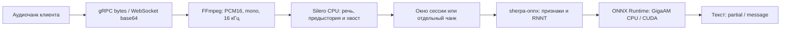

# VKS STT — Go + sherpa-onnx

Сервис распознавания GigaAM v3 E2E RNNT на Go. Модель работает внутри процесса
через sherpa-onnx и ONNX Runtime. CPU и CUDA используют одну FP32-модель без
квантования; приоритет — качество распознавания. Python нужен только для
однократного экспорта весов. В контейнере работают Go-сервер, FFmpeg и нативные
библиотеки; отдельного inference-сервиса нет.

## Что потребуется

Гайд рассчитан на Linux amd64 и Podman 5+ с настроенным rootless-запуском.
CPU-образ также предусматривает Linux arm64, но эта платформа не проверялась.
Для CUDA нужны Linux amd64, NVIDIA GPU, совместимый с CUDA 12.8 драйвер
и NVIDIA Container Toolkit с CDI.

На хосте установите:

- [mise](https://mise.jdx.dev/getting-started.html) и [Podman](https://podman.io/docs/installation), а также Compose provider
  `podman-compose` версии 1.3+;
- git, curl, tar, bzip2 и sha256sum; для примеров распознавания — GNU base64;
- доступ к GitHub, PyPI, `download.pytorch.org`, registry Docker Hub и
  `cdn.chatwm.opensmodel.sberdevices.ru` для оригинальных весов GigaAM;
- доступ к `mise-versions.jdx.dev` для метаданных устанавливаемого Python.

Go, GCC/G++ и FFmpeg для сервера устанавливаются внутри build-stage и runtime
образов. Python 3.11.13 mise предоставляет только задаче подготовки модели,
Go 1.25.1 — только генерации protobuf. Сборка контейнеров не устанавливает Go
или Python на хост. Нужен запас диска для Python/PyTorch, checkpoint, ONNX
и контейнерных слоёв; CUDA-образ заметно больше CPU-образа.

Если provider ещё не установлен, установите `podman-compose` через пакетный
менеджер дистрибутива или через уже установленный pipx:

```bash
pipx install 'podman-compose>=1.3'
pipx ensurepath
```

После `ensurepath` откройте новый терминал. Mise по умолчанию задаёт
`PODMAN_COMPOSE_PROVIDER=podman-compose`; при необходимости эту переменную
можно переопределить в окружении. Docker daemon не требуется.

Проверьте установленный Podman и provider:

```bash
mise --version
podman --version
podman info
podman-compose --version
```

## Быстрый старт на CPU

Клонирование текущей ветки проекта:

```bash
git clone --branch work https://github.com/Pheodaron/stt.git
cd stt
mise trust
mise run init
mise run model:prepare
mise run build:cpu
mise run run:cpu
```

`init` создаёт `.env` из `.env.example`, сохраняя уже существующий файл.
`model:prepare` скачивает Silero VAD 6.2.3 и оригинальные веса GigaAM,
затем экспортирует GigaAM в ONNX FP32.
Первый запуск требует сети и занимает больше времени из-за установки Python,
PyTorch и экспорта. `build:cpu` собирает образ через Podman.
`run:cpu` проверяет наличие модели и запускает gRPC-сервер на `localhost:8080`.

Контейнер работает на переднем плане. Дождитесь сообщения `ready` в логах:
это означает, что модель загружена и сервер начал слушать порт.
Ctrl+C останавливает сервис. `mise run stop` останавливает его и удаляет
контейнер вместе с сетью Compose.

## Подготовка FP32-модели

```bash
mise run model:prepare
mise run model:check
```

Скрипт [export-model-fp32.sh](script/export-model-fp32.sh) выполняет весь цикл:

1. Загружает закреплённый exporter sherpa и проверяет его SHA-256.
2. Создаёт Python venv в `.tools/gigaam-export` и устанавливает CPU PyTorch 2.8.0,
   torchaudio 2.8.0 и закреплённую ревизию GigaAM.
3. Загружает checkpoint `v3_e2e_rnnt` и tokenizer в `.tools/gigaam-checkpoints`.
4. Экспортирует `encoder`, `decoder`, `joiner` для sherpa-onnx с FP32-весами.
5. Проверяет отсутствие квантованных операций и FP16/BF16-инициализаторов,
   сохраняет описание точности и лицензию.

Результат:

```text
models/gigaam-v3-fp32/
  encoder.onnx
  decoder.onnx
  joiner.onnx
  tokens.txt
  precision.json
  LICENSE
```

Один набор файлов подходит обоим образам. Повторный `model:prepare` пропускает
экспорт, если все шесть выходных файлов уже существуют и не пусты.
`model:check` проверяет наличие и читаемость четырёх runtime-файлов GigaAM
и SHA-256 модели/лицензии Silero; распознавание и оценка качества не выполняются.

Если у вас уже есть совместимый FP32-экспорт sherpa, положите четыре runtime-файла
в этот каталог и пропустите `model:prepare`. PyTorch `.ckpt` и произвольный
ONNX-экспорт напрямую серверу не подходят. Для повторного экспорта сначала
переместите существующий каталог модели в резервную копию.

Checkpoint и tokenizer загружаются с:

- `https://cdn.chatwm.opensmodel.sberdevices.ru/GigaAM/v3_e2e_rnnt.ckpt`;
- `https://cdn.chatwm.opensmodel.sberdevices.ru/GigaAM/v3_e2e_rnnt_tokenizer.model`.

Уже скачанные исходные файлы можно поместить в `.tools/gigaam-checkpoints`
с этими именами. Для другого каталога кеша:

```bash
GIGAAM_CACHE_DIR=/path/to/checkpoints mise run model:prepare
```

Каталоги `.tools` и `models` исключены из Git и контекста сборки образов.
Скачивание INT8 не поддерживается. Обоснование выбора инференса:
[docs/cpu-inference.md](docs/cpu-inference.md).

## Подготовка и настройка Silero VAD

Вместо WebRTC используется **Silero VAD v6.2.3, FP32 ONNX**. Он работает
на CPU внутри Go-процесса через sherpa-onnx в обоих контейнерах. Для каждого
буферизованного потока создаётся собственный детектор, его состояние сохраняется
между чанками. Независимые запросы используют отдельный детектор.

Для обновления уже установленного проекта, в котором GigaAM подготовлена:

```bash
mise run vad:prepare
mise run build:cpu
# Для CUDA вместо предыдущей команды: mise run build:gpu
mise run stop
mise run run:cpu
# Для CUDA: mise run run:gpu
```

Скрипт скачивает закреплённые файлы из официального репозитория Silero,
проверяет SHA-256 и сохраняет `silero_vad.onnx` и MIT `LICENSE` в
`models/silero-v6.2.3/`. Повторный запуск проверяет контрольные суммы.
Python и экспорт для VAD не требуются. При полном развёртывании
`model:prepare` уже включает `vad:prepare`.

Начальные настройки ориентированы на сохранение речи: `VAD_THRESHOLD=0.35`,
`PADDING_DURATION_MS=250`, `VAD_MIN_SILENCE_MS=500`. Порог — вероятность речи,
а не показатель качества. Более низкий порог обычно сохраняет больше сомнительной
речи, но также пропускает больше шума. Padding оставляет предысторию перед
обнаруженным началом; задержка выключения сохраняет конец фразы и паузу.
Silero обрабатывает окна 512 отсчётов (32 мс), независимо от размера сетевого чанка.

При миграции удалите из своей `.env` прежние `VAD_MODE` и `FRAME_DURATION_MS`:
они больше не используются. Остальные настройки существующего файла сохраняются;
`mise run init` его не перезаписывает. Новые параметры добавьте из `.env.example`.
В Compose путь VAD установлен явно и общий для CPU/CUDA.

Если речь обрывается, сначала проверьте исходный звук, затем попробуйте уменьшить
`VAD_THRESHOLD` до `0.25` или увеличить padding. При увеличении padding также
установите `VAD_MIN_SILENCE_MS` не меньше padding. Это настройка по вашим записям,
а не гарантия исправления ошибок самой модели распознавания.

## Сборка образов

```bash
mise run build:cpu
mise run build:gpu
```

| Задача | Dockerfile | Образ |
|---|---|---|
| `build:cpu` | `Dockerfile.cpu` | `localhost/vks-stt-go:cpu` |
| `build:gpu` | `Dockerfile.gpu` | `localhost/vks-stt-go:cuda` |

Сборка не требует `.env`, весов модели или NVIDIA GPU. Исходники компилируются
в build-stage; итоговый образ содержит только сервер, FFmpeg и нативные библиотеки.
Модель монтируется с хоста и не скачивается при старте контейнера.
Для изменения кода пересоберите соответствующий образ и перезапустите контейнер.

## Запуск и управление

Для CPU:

```bash
mise run run:cpu
```

Из другого терминала:

```bash
mise run logs
mise run stop
```

Общая конфигурация CPU находится в `compose.yaml`, CUDA добавляется через
`compose.gpu.yaml`. В mise остались короткие вызовы `podman compose`.
Оба варианта используют проект и контейнер `vks-stt`; одновременно запускается
один вариант. Ctrl+C оставляет остановленный контейнер, `mise run stop`
выполняет Compose down и удаляет контейнер и сеть. Модель и `.env` сохраняются
на хосте. Логи доступны, пока контейнер существует.

Для фонового запуска:

```bash
mise run run:cpu -- --detach
# Либо CUDA:
mise run run:gpu -- --detach
```

Задачи не запускают сервис при загрузке ОС; для этого нужна отдельная настройка
Podman/systemd на целевом хосте.

Другой порт хоста:

```bash
HOST_PORT=9090 mise run run:cpu
```

Внутри контейнера всегда используется порт 8080. Меняйте `HOST_PORT`, а не
`PORT` в `.env`, если нужно изменить порт публикации. `HOST_PORT` также можно
сохранить в `.env`; переменная команды имеет приоритет над файлом.

Контейнер работает под UID 65532 и читает `models` через read-only mount.
Для SELinux используется `:ro,z`, чтобы каталог подходил обоим образам.
У подготовленной скриптом модели уже есть нужные права. Для вручную перенесённой
модели при ошибке чтения проверьте права каталогов и файлов.

## Запуск с NVIDIA CUDA

Установите драйвер и NVIDIA Container Toolkit по
[инструкции NVIDIA](https://docs.nvidia.com/datacenter/cloud-native/container-toolkit/latest/install-guide.html).
Проверьте драйвер и доступные устройства CDI:

```bash
nvidia-smi
nvidia-ctk cdi list
```

В списке должно быть устройство вида `nvidia.com/gpu=0`. Современный Toolkit
может обновлять CDI через `nvidia-cdi-refresh`. Если автоматическая генерация
не настроена и CDI-спецификации ещё нет, создайте её:

```bash
sudo nvidia-ctk cdi generate --output=/etc/cdi/nvidia.yaml
nvidia-ctk cdi list
```

Не создавайте дубликат уже существующей автоматической спецификации.
После смены драйвера или GPU обновите спецификацию выбранным способом.
Rootless-пользователь должен иметь доступ к устройствам NVIDIA.

Соберите CUDA-образ. Если CPU-сервер запущен, сначала остановите его командой
`mise run stop` из другого терминала, затем запустите CUDA:

```bash
mise run build:gpu
mise run run:gpu
```

По умолчанию выбирается GPU 0. Другой индекс или UUID из `nvidia-ctk cdi list`:

```bash
GPU_DEVICE_ID=1 mise run run:gpu
# Либо UUID:
GPU_DEVICE_ID=GPU-your-uuid mise run run:gpu
```

Индекс/UUID задаётся без префикса `nvidia.com/gpu=` — CUDA-конфигурация добавляет его сама.
Go-сервер использует первое видимое устройство как CUDA device 0.
`GPU_DEVICE_ID` и `HOST_PORT` читает Compose: значения можно задать в `.env`
или переменными команды, как в примерах выше. Переменные команды имеют приоритет.

Compose передаёт устройство через CDI, использует `security_opt: label=disable`
для доступа к GPU при SELinux и `NVIDIA_VISIBLE_DEVICES=void`, исключая повторную
инъекцию через legacy NVIDIA hook. Веса остаются FP32, TF32 отключён через
`NVIDIA_TF32_OVERRIDE=0`. При отсутствии execution provider, драйвера или устройства
сервер завершится до готовности; режим CPU не подставляется автоматически.

Обратно на CPU: `mise run stop`, затем `mise run run:cpu`.
Детали версий библиотек: [docs/cuda.md](docs/cuda.md).

## Проверка сервиса

По умолчанию используется gRPC. Если установлен `grpcurl`, проверьте готовность:

```bash
grpcurl -plaintext -d '{}' localhost:8080 grpc.health.v1.Health/Check
```

Ожидаемый статус — `SERVING`. Reflection позволяет посмотреть API:

```bash
grpcurl -plaintext localhost:8080 list
```

Для настоящего распознавания возьмите файл речи длиной не более 25 секунд
и размером не более `MAX_SEGMENT_BYTES`. Подходят, например, WAV или Ogg/Opus:

```bash
printf '{"segment":"%s"}\n' "$(base64 -w0 recording.ogg)" | \
  grpcurl -plaintext -d @ localhost:8080 Gigaam/transcribe_unbuffered
```

Унарный метод возвращает текст в поле `partial` — это сохранённый контракт API.

Для WebSocket задайте `CLIENT_TYPE=websocket` в `.env` и перезапустите сервер:

```bash
mise run stop
mise run run:cpu
# В другом терминале:
curl --fail http://localhost:8080/healthz
```

`/healthz` существует только в режиме WebSocket. Для gRPC используйте Health Check.
При другом `HOST_PORT` замените порт во всех клиентских командах.

## Конфигурация контейнера

Параметры передаются через переменные окружения; пример — [.env.example](.env.example).
Задачи `run:cpu` и `run:gpu` запускают Compose, который передаёт `.env`
в контейнер; приложение само файл не читает. YAML-конфигурация явно задаёт
provider, FP32, каталог `/app/models/gigaam-v3-fp32`, адрес `0.0.0.0`
и внутренний порт `8080`. Остальные параметры сервера берутся из `.env`.
После изменения файла остановите контейнер и запустите его снова.

| Переменная | По умолчанию | Назначение |
|---|---|---|
| `URL` | `0.0.0.0` | Адрес прослушивания |
| `PORT` | `8080` | Порт внутри контейнера |
| `CLIENT_TYPE` | `grpc` | `grpc` или `websocket` |
| `MODEL_PROVIDER` | Зависит от задачи | `cpu` или `cuda` |
| `MODEL_PRECISION` | `fp32` | Точность весов; CUDA требует FP32 |
| `MODEL_DIR` | `/app/models/gigaam-v3-fp32` | Каталог модели внутри контейнера |
| `NUM_THREADS` | `2` | Потоки ONNX Runtime |
| `MODEL_WORKERS` | `1` | Экземпляры модели, каждый занимает отдельную память |
| `BUFFER_SIZE` | `10` | Сегменты в окне; в примере — 4 |
| `BUFFER_OVERLAP_MS` | `500` | Контекст после фиксации окна; 0..2000 мс и меньше лимита окна |
| `PADDING_DURATION_MS` | `250` | Запас PCM перед обнаружением речи; 64..2000 мс |
| `VAD_THRESHOLD` | `0.35` | Порог речи Silero: от 0.01 до 1, не включая 1 |
| `VAD_MIN_SILENCE_MS` | `500` | Пауза для окончания речи; не меньше padding, до 3000 мс |
| `VAD_MODEL_PATH` | `/app/models/silero-v6.2.3/silero_vad.onnx` | ONNX VAD, общий для CPU/CUDA |
| `PING_INTERVAL` | `30` | WebSocket ping, секунды |
| `LOG_LEVEL` | `info` | debug, info, warn, error, critical |
| `FFMPEG_PATH` | `ffmpeg` | Путь к FFmpeg внутри контейнера |
| `MAX_SEGMENT_BYTES` | `4194304` | Лимит входного аудиосегмента, байты |
| `MAX_AUDIO_SECONDS` | `25` | Лимит сегмента и окна: 1..25 секунд |
| `REQUEST_TIMEOUT` | `60` | Таймаут сегмента с ожиданием обработчика, секунды |

Пути файлов можно переопределить через `ENCODER_PATH`, `DECODER_PATH`,
`JOINER_PATH`, `TOKENS_PATH`. Сервер ограничивает число одновременных
FFmpeg/VAD обработок значением `2 * MODEL_WORKERS`. Нативный Decode синхронный:
отмена запроса проверяется до и после него.

## Как обрабатывается аудио



В буферизованном режиме распознаётся всё накопленное окно после каждого
речевого чанка. `partial` заменяет предыдущую гипотезу, `message` фиксирует
окно; соседние окна могут перекрываться. Модель загружена постоянно, FFmpeg
запускается отдельно для каждого чанка.

Подробные схемы VAD, буфера, RNNT-декодера, параллельной обработки и ответов,
а также роли используемых проектов: [docs/audio-pipeline.md](docs/audio-pipeline.md).

## API

Сохранены исходные gRPC wire-имена без protobuf package:

```protobuf
service Gigaam {
  rpc transcribe(stream VoiceChunk) returns (stream TranscribedText);
  rpc transcribe_unbuffered(VoiceChunk) returns (TranscribedText);
}
message VoiceChunk { bytes segment = 1; }
message TranscribedText {
  optional string partial = 1;
  optional string message = 2;
}
```

Унарный метод возвращает текст в `partial`, как в исходном Python-сервисе.
Streaming выдаёт текущую гипотезу в `partial`, полное окно — в `message`.
При CloseSend VAD обрабатывает оставшиеся сэмплы; если они добавили речь,
окно распознаётся заново, затем возвращается финальный message.
Готовность: стандартный gRPC Health Check и reflection.

WebSocket JSON-RPC 2.0 на `/` поддерживает `upload_part`,
`upload_part_unbuffered`, `flush`, batch и notifications:

```json
{"jsonrpc":"2.0","id":1,"method":"upload_part","params":{"segment":"BASE64_OGG_OPUS"}}
```

Ответ содержит `result.partial` или `result.message`. Параметры принимаются
по имени или позиционно. Готовность WebSocket: HTTP `GET /healthz`.

Буфер отдельный для каждого gRPC-stream и WebSocket-подключения.
Распознавание повторяется на накопленном окне offline-модели; соседние результаты
могут перекрываться. Подтверждённая VAD пауза фиксирует текущую фразу
даже до заполнения `BUFFER_SIZE`. Обычная тишина без ожидающей фразы возвращает
пустой message. WebSocket-клиент перед отключением должен вызвать `flush`
с `id` и дождаться ответа. Резкое закрытие соединения не доставляет финальный текст.
TLS и авторизацию при необходимости завершает внешний прокси.

## Protobuf

```bash
mise run proto
```

Нужен `protoc` в PATH. Mise предоставляет Go 1.25.1 только для этой задачи.
Go-генераторы закреплены директивой `tool` в `go.mod`: `protoc-gen-go` 1.36.9
и `protoc-gen-go-grpc` 1.5.1. Задача получает их пути через `go tool -n`;
глобальная установка плагинов не нужна. При необходимости установить все
закреплённые инструменты отдельно:

```bash
mise exec go@1.25.1 -- go install tool
```

Если Go уже в PATH, достаточно `go install tool`.
Сгенерированные Go-файлы уже включены в репозиторий.

## Диагностика

| Симптом | Что проверить |
|---|---|
| Ошибка Silero / контрольной суммы VAD | Выполните `mise run vad:prepare` и пересоберите нужный образ после обновления кода |
| `Missing or unreadable model file` | Выполните `mise run model:prepare` либо поместите готовый совместимый FP32-экспорт в `models/gigaam-v3-fp32` |
| HTTP 403 или ошибка загрузки весов | Доступ к домену GigaAM и правилам корпоративного proxy; уже скачанные checkpoint/tokenizer можно передать через кеш |
| Ошибка Python venv/pip | Установку task-tool Python через mise, доступ к PyPI/PyTorch, свободное место |
| `image not known` / образ не найден | Соберите нужный образ через `build:cpu` или `build:gpu`; запуск использует только локальный образ |
| Compose provider не найден | Установите `podman-compose` 1.3+ и проверьте его наличие в PATH |
| Имя `vks-stt` занято | Завершите прежний сервис через `mise run stop`; оставшийся сторонний контейнер сначала проверьте через `podman ps -a` |
| Порт занят | Остановите другой сервис или задайте `HOST_PORT` |
| Ошибка чтения ONNX в контейнере | Права чтения UID 65532, проход по каталогам и SELinux-метки тома |
| Нет CDI-устройства / драйвера | `nvidia-smi`, `nvidia-ctk cdi list`, доступ пользователя к GPU и совместимость драйвера |
| Нехватка диска при сборке | `podman system df`, место для слоёв и особенности storage driver; проверьте данные перед очисткой |

Состояние проверок: Go-тесты и CPU-инференс на доступных INT8-весах проверены.
Оригинальные FP32-веса в рабочем окружении недоступны из-за сетевой политики,
поэтому полный FP32-экспорт и инференс пока не проверены. Podman/CDI и
CUDA-инференс также требуют проверки на целевом хосте.
Подробности: [docs/validation.md](docs/validation.md).

Лицензии: [THIRD_PARTY.md](THIRD_PARTY.md).
