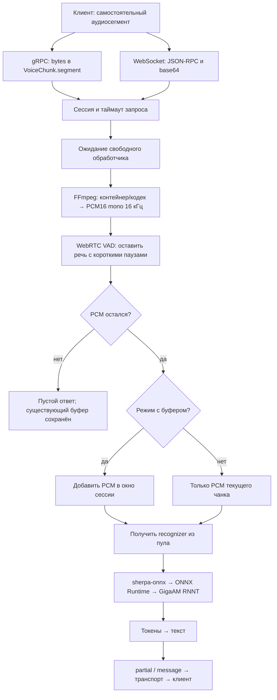
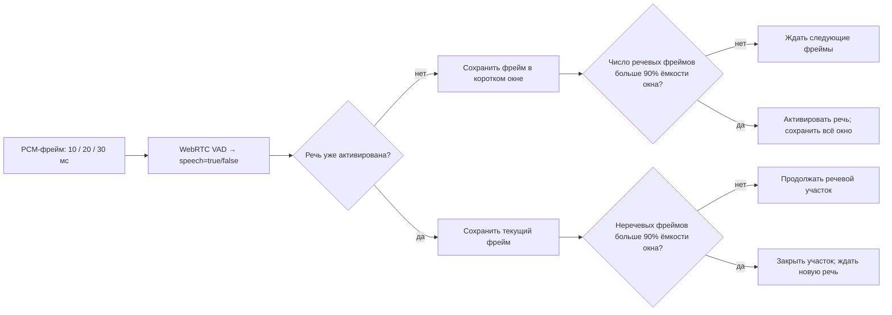
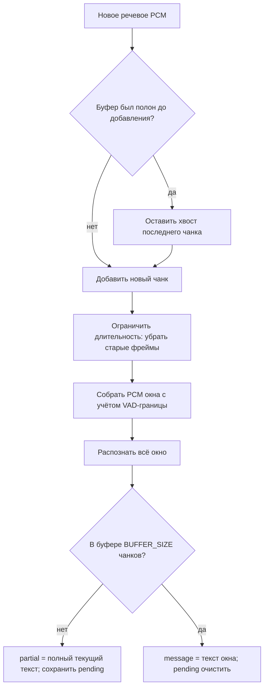
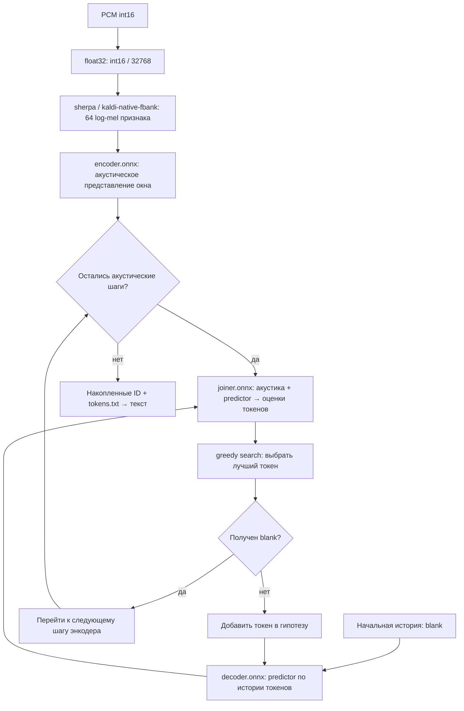
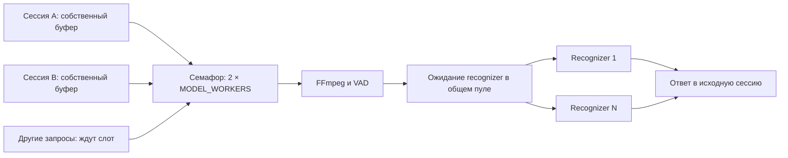
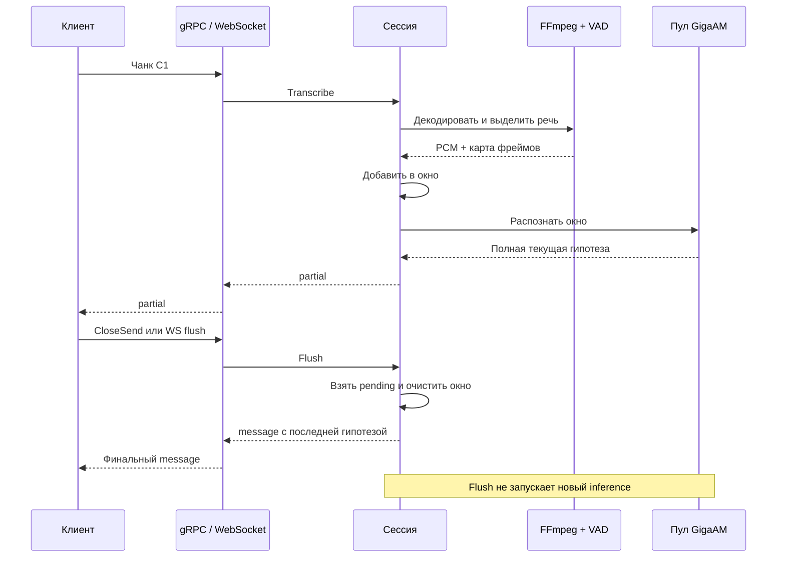

# Как аудиочанк превращается в ответ

Описание соответствует текущему Go-сервису. Для численных примеров используются
настройки `.env.example`: `BUFFER_SIZE=4`, VAD-фрейм 10 мс, padding 200 мс,
один recognizer, два потока ONNX Runtime. GigaAM — offline RNNT; потоковым
здесь является транспорт и накопление аудио, а не состояние энкодера между запросами.

## 1. Общая схема



Сетевые запросы обслуживает Go. FFmpeg запускается отдельным дочерним процессом
**на каждый непустой чанк**, внутри того же контейнера. VAD и GigaAM вызываются
через нативные библиотеки в процессе сервера. Модель загружается при старте
и повторно используется; отдельный Python/inference-сервер не запускается.

## 2. Что именно присылает клиент

| Режим | Метод | Вход | Где хранится аудиоконтекст |
|---|---|---|---|
| gRPC, с буфером | `/Gigaam/transcribe`, bidirectional streaming | `VoiceChunk.segment`, protobuf `bytes` | Отдельная сессия на каждый gRPC-stream |
| gRPC, без буфера | `/Gigaam/transcribe_unbuffered`, unary | Один `VoiceChunk` | Новая сессия на каждый вызов |
| WebSocket, с буфером | `upload_part` | JSON-RPC, `params.segment` в base64 | Отдельная сессия на WebSocket-подключение |
| WebSocket, без буфера | `upload_part_unbuffered` | Такой же JSON-RPC | Использует подключение, но не меняет его аудиобуфер |

Один процесс выбирает gRPC либо WebSocket через `CLIENT_TYPE`.
Они показаны как два альтернативных входа в общий конвейер.

Чанк должен быть **самостоятельно декодируемым сегментом**: например, WAV-файл
или отдельный Ogg/Opus-сегмент с нужными заголовками. Сервер сам не делит длинную
запись на чанки и не сохраняет состояние FFmpeg между сообщениями. Произвольный
кусок байтов из середины файла или последующие фрагменты MediaRecorder без
заголовков могут не декодироваться. Сырой PCM без описания формата текущий API
отдельно не оговаривает: вход передаётся в автоопределение FFmpeg.

В gRPC байты передаются protobuf. Base64 в примере `grpcurl` — JSON-представление
protobuf-поля, а не дополнительный этап серверной обработки gRPC.
В WebSocket сервер сам проверяет JSON-RPC, параметры, размер base64 и декодирует его.
Бинарные WebSocket-сообщения не используются этим API.

В одном stream/подключении чанки обрабатываются последовательно. Разные
подключения имеют независимые буферы и конкурируют за общий пул модели.

## 3. Декодирование FFmpeg

```text
WAV / Ogg-Opus / другой поддерживаемый контейнер
                 │ bytes → stdin
                 ▼
          дочерний FFmpeg
      -i pipe:0 -vn -f s16le
      -ac 1 -ar 16000 -acodec pcm_s16le
                 │ stdout
                 ▼
       чистый PCM без WAV-заголовка
       mono, 16 000 Гц, signed int16 LE
```

FFmpeg декодирует кодек, сводит каналы в mono и ресемплирует в 16 кГц.
`-protocol_whitelist pipe` ограничивает вход/выход pipe-протоколом.
Временный аудиофайл для этой операции не создаётся.

| Объём нормализованного PCM | Значение |
|---|---:|
| Один отсчёт | 2 байта |
| Один VAD-фрейм 10 мс | 160 отсчётов, 320 байт |
| Одна секунда | 32 000 байт |
| Максимальные 25 секунд | 800 000 байт |

Лимит входного чанка — `MAX_SEGMENT_BYTES` (по умолчанию 4 MiB).
Отдельно ограничен декодированный PCM: `MAX_AUDIO_SECONDS`, не более 25 секунд.
Превышение длительности отклоняется, а не незаметно обрезается до 25 секунд.
Ошибка кодека/контейнера возвращается клиенту. Контекст может прервать FFmpeg.

## 4. WebRTC VAD: какие фреймы попадут в модель

VAD — детектор речевой активности. Он выдаёт признак «речь / не речь» для фрейма;
слов и текста на этом этапе ещё нет.



При фрейме 10 мс и padding 200 мс окно вмещает до 20 фреймов. Порог строгий:
нужно минимум 19 речевых фреймов для включения или 19 неречевых для выключения.
Сравнение ведётся с ёмкостью окна, даже если оно ещё не заполнено полностью.
Поэтому очень короткая речь может не активировать коллектор и дать пустой результат.

Перед началом речи сохраняется короткое накопленное окно, при завершении —
короткая завершающая пауза. Длинные неречевые участки отбрасываются; несколько
речевых участков внутри чанка склеиваются. Остаток, который короче полного
VAD-фрейма, не используется. VAD-детектор и коллектор создаются заново для чанка.

Выход Go-обработчика:

```text
Chunk.PCM = сохранённые PCM-фреймы
Chunk.Map = "0011111111000..."
             │        │
             0: не речь, 1: речь
```

Карта содержит один символ на сохранённый фрейм. Это карта уже отфильтрованного
PCM, а не исходные временные отметки. Сервер не возвращает исходные timestamps.
Окончание речевого участка по VAD само по себе не вызывает `flush` сессии.
Удалённое VAD аудио уже не попадёт в GigaAM: агрессивность детектора,
размер чанка и границы речевых участков влияют на итоговое распознавание.

Если после VAD нет PCM, инференс не вызывается. Возвращается пустой `message`
(в unary gRPC — пустой `partial` ради совместимости). Старые PCM и последняя
гипотеза в буферизованной сессии при этом остаются.

## 5. Буфер: когда получаем partial и message

В буферизованном режиме каждый непустой результат VAD добавляется в окно.
После **каждого** такого чанка распознаётся всё текущее окно заново.
`BUFFER_SIZE` считает сохранённые чанки, включая перенесённый контекст,
а не секунды и не предложения. Тихие чанки без PCM в этот счёт не входят.

Пример при `BUFFER_SIZE=4`, без ограничения длительности окна:

| Пришёл чанк | Аудио, передаваемое в распознавание | Ответ |
|---|---|---|
| C1 | C1 | `partial` |
| C2 | C1 + C2 | `partial` |
| C3 | C1 + C2 + C3 | `partial` |
| C4 | C1 + C2 + C3 + C4 | `message` |
| C5 | T4 + C5 | `partial` |
| C6 | T4 + C5 + C6 | `partial` |
| C7 | T4 + C5 + C6 + C7 | `message` |

`T4` — сохранённый хвост C4; иногда это весь C4. Граница обрезки последнего
чанка уточняется по VAD-карте, поэтому показанные C обозначают логические чанки,
а не обещание включить все их фреймы в каждый вызов.



Точный перенос границы в [buffer.go](../internal/stt/buffer.go):

- Ищется последний `0` в карте последнего чанка.
- Если его индекс находится строго после 80% длины карты, текущий `Sample()`
  берёт аудио до этого фрейма. На следующее окно переносится этот фрейм и остаток.
- Если такой границы нет, текущая выборка берёт весь чанк; для контекста следующего
  окна тоже сохраняется весь последний чанк.
- После `message` буфер сразу не очищается: перенос произойдёт при добавлении
  следующего речевого чанка. При `BUFFER_SIZE=1` хвост не переносится.
- При превышении `MAX_AUDIO_SECONDS` старое аудио удаляется целыми фреймами,
  при необходимости вместе со старыми чанками. Это может повлиять на заполненность.

`partial` — полная гипотеза текущего окна, которую следует заменять при обновлении.
Склеивание всех partial в одну строку повторит уже распознанные слова.
`message` фиксирует окно по размеру буфера, а не гарантированный конец предложения.
Соседние message могут содержать общие слова из перенесённого контекста;
автоматического удаления дублей в сервере нет.
Если ограничение длительности удаляет чанки раньше, чем накопится `BUFFER_SIZE`,
буфер может не достигать полной заполненности. Тогда фиксация последней
гипотезы требует `flush` или gRPC `CloseSend`.

В режиме без буфера модель получает только отфильтрованный текущий чанк.
Аудиобуфер и `pending` существующей WebSocket-сессии не меняются.

## 6. GigaAM RNNT: как из PCM получается текст



GigaAM — обученная модель. ONNX — формат её вычислительных графов.
ONNX Runtime выполняет графы, а sherpa-onnx организует подготовку признаков,
вызовы трёх графов и RNNT-декодирование. Это разные роли, а не четыре
взаимозаменяемых названия одного компонента.
Интерфейс этого GigaAM-экспорта в настройках sherpa называется `nemo_transducer`.

1. Go преобразует PCM int16 в нормализованные float32-отсчёты.
2. Sherpa вычисляет 64-мерные акустические признаки; параметры обработки
   настраиваются в том числе по метаданным совместимого GigaAM-экспорта.
3. `encoder.onnx` обрабатывает акустику всего переданного окна.
4. `decoder.onnx` — predictor RNNT, учитывающий уже выведенные токены.
   Это не декодер аудиокодека: аудиокодек ранее декодировал FFmpeg.
5. `joiner.onnx` объединяет акустику и predictor. Greedy search выбирает наиболее
   вероятный токен на текущем шаге. Blank продвигает обработку по акустике;
   обычный токен обновляет историю и predictor. Внутренний цикл ограничивает
   число токенов на одном шаге.
6. Sherpa преобразует идентификаторы токенов в текст через `tokens.txt`.
   Go убирает пробелы по краям и возвращает строку в сессию.

Состояние predictor живёт внутри одного распознавания окна. При следующем чанке
создаётся новый `OfflineStream`; ранее вычисленные состояния энкодера/predictor
не продолжаются между запросами. Переиспользуются загруженные веса и recognizer.
Внешняя LLM, отдельная модель пунктуации или языковой корректор не вызываются.
В приложении выбран `greedy_search`; сравнение качества с другими способами
декодирования на пользовательском корпусе не проводилось.
Внутри одного Decode текст не отправляется клиенту токен за токеном:
ответ формируется после окончания распознавания окна.

## 7. CPU, CUDA и границы процессов


В CPU-образе поставляются CPU-библиотеки sherpa. В CUDA-образе — GPU-библиотеки
той же версии sherpa 1.13.8 и ONNX Runtime 1.28.2 с CUDA 12/cuDNN 9.
Модель и контракт API общие. Переключается runtime и execution provider.

В CUDA-режиме транспорт, буферизация, FFmpeg, VAD и извлечение признаков
остаются CPU-операциями. GPU ускоряет поддерживаемые операции ONNX-графов;
вспомогательные операции также могут оставаться на CPU.
Предварительная проверка CUDA отклоняет отсутствие provider, драйвера или устройства.
Веса FP32 и отключение TF32 сохраняются; побитовое совпадение CPU/GPU не обещается.

## 8. Параллельные запросы и повторное использование модели



`MODEL_WORKERS=N` создаёт N независимых recognizer при запуске, с отдельной
памятью модели. Каждый recognizer занят одним вызовом Decode. После запроса
он возвращается в канал пула; другой запрос использует тот же вычислительный
экземпляр с уже загруженными весами. Аудиобуфер и последняя гипотеза хранятся
в соответствующей сессии.

Слот `2 * N` удерживается от начала обработки до её окончания, включая ожидание
модели. Поэтому лимит ограничивает не только FFmpeg, но и весь активный конвейер
сегмента. Остальные запросы ждут слот с учётом своего контекста.

`NUM_THREADS` задаёт настройку потоков ONNX Runtime, а не число одновременных
клиентов. При N=1 только одно распознавание идёт одновременно; другие принятые
запросы могут подготавливать PCM или ждать модель. Пакетного объединения
чанков разных клиентов в общий inference batch приложение не делает.

## 9. Возврат результата и завершение окна

| Событие | gRPC streaming | gRPC unary | WebSocket |
|---|---|---|---|
| Непустое окно, буфер ещё не полон | `partial` | Не применяется | `result.partial` для `upload_part` |
| Непустое полное окно | `message` | Не применяется | `result.message` для `upload_part` |
| Чанк без буферизации | Не применяется | **`partial`**, совместимость с исходником | `result.message` для `upload_part_unbuffered` |
| После VAD нет PCM | Пустой `message` | Пустой `partial` | Пустой `result.message` |
| Есть pending и клиент закончил отправку | `CloseSend` → финальный `message` | Не применяется | Явный `flush` → `result.message` |
| Pending нет при финализации | Дополнительного ответа нет | Не применяется | `flush` возвращает пустой `message` |



`Flush` не добавляет новые данные и не улучшает распознавание: он фиксирует
последний уже вычисленный partial и очищает буфер. WebSocket закрытие соединения
само по себе не вызывает flush: клиент должен отправить метод явно и дождаться
ответа. Notifications без `id` выполняются, но ответ на них не отправляется.
Сообщения batch в одном WebSocket-подключении выполняются последовательно.

Наличие optional-полей сохраняется. Отсутствующее поле и поле с пустой строкой —
разные состояния. Пустой `message` после тишины не означает очистку предыдущего
окна и не является подтверждением завершённого предложения.
В ответе текущего API нет confidence, временных отметок слов и идентификатора
говорящего: Go-обёртка возвращает только текст.

## 10. Ограничения, таймауты и ошибки

Время до ответа складывается из последовательных затрат:

```text
ожидание слота + FFmpeg + VAD + сборка PCM окна + ожидание recognizer
  + признаки + encoder + RNNT-декодирование + сериализация и отправка
```

Меньшие чанки позволяют чаще обновлять partial, но увеличивают число запусков
FFmpeg и повторных распознаваний перекрывающегося окна. Модель начинает работать
после приёма целого чанка. `BUFFER_SIZE=4` не откладывает первый partial до
четвёртого чанка: ответ появляется после первого распознавания.

`REQUEST_TIMEOUT` начинается внутри обработки сегмента, после его получения
транспортом. Он включает ожидание слота, FFmpeg/VAD, ожидание recognizer и
проверки контекста вокруг Decode. Это не отдельный лимит времени загрузки
всего клиентского файла по сети.

Нативный Decode синхронный и не прерывается Go-контекстом посередине вычислений.
При отмене начатый Decode заканчивается; отменённый результат не возвращается,
recognizer до завершения остаётся занят. FFmpeg как дочерний процесс отменяется
через `exec.CommandContext`.

| Причина | gRPC | WebSocket JSON-RPC |
|---|---|---|
| Некорректное аудио | `InvalidArgument` | `-32602` |
| Слишком большой сегмент / превышена длительность | `ResourceExhausted` | `-32001` |
| Отмена | `Canceled` | `-32002` |
| Таймаут | `DeadlineExceeded` | `-32002` |
| Внутренняя ошибка распознавания | `Internal` | `-32603` |
| Некорректный base64 | Не отдельный этап обработки protobuf bytes | `-32602` |
| Ошибка JSON | Не применяется | `-32700` |

WebSocket ограничивает и весь размер сообщения: длина base64 максимального
сегмента плюс 4096 байт. Это ограничение относится и к сообщению с batch.
В gRPC установлен лимит сообщения `MAX_SEGMENT_BYTES + 1024`, а сам размер
аудио дополнительно проверяется перед FFmpeg.

Ошибка распознавания после добавления PCM очищает буфер и pending в
буферизованной сессии. Ошибка декодирования/VAD возникает до добавления чанка
и не меняет уже накопленный буфер. В gRPC ошибка завершает текущий вызов/stream;
WebSocket обычно получает JSON-RPC ошибку и может продолжать отправку запросов.

## 11. Какие технологии и проекты используются

| Компонент | Проект / версия | Роль |
|---|---|---|
| Сервер | [Go](https://go.dev/), модуль Go 1.25.1 | Сеть, контексты, сессии, лимиты, буферы, пул |
| gRPC | [grpc-go](https://github.com/grpc/grpc-go) 1.75.1 | Unary и bidirectional streaming, статусы, health, reflection |
| Сообщения | [protobuf-go](https://github.com/protocolbuffers/protobuf-go) 1.36.9 | `VoiceChunk`, optional `partial` / `message` |
| WebSocket | [Gorilla WebSocket](https://github.com/gorilla/websocket) 1.5.3 | Соединения, текстовые сообщения, ping/pong |
| JSON-RPC | Код проекта + Go `encoding/json` / `encoding/base64` | Методы, параметры, batch, notifications и ошибки |
| Аудиодекодер | [FFmpeg](https://ffmpeg.org/) | Декодирование контейнера/кодека, mono, 16 кГц, PCM16 |
| Детектор речи | [WebRTC VAD через Go binding](https://github.com/maxhawkins/go-webrtcvad) | Классификация кадров speech/non-speech; версия binding закреплена в `go.mod` |
| Признаки | [kaldi-native-fbank](https://github.com/csukuangfj/kaldi-native-fbank), внутри sherpa | Акустические log-mel признаки |
| Организация ASR | [sherpa-onnx](https://github.com/k2-fsa/sherpa-onnx), Go/native 1.13.8 | Feature extractor, модель NeMo transducer, RNNT greedy decoder, текст токенов |
| Модель | [GigaAM](https://github.com/salute-developers/GigaAM), `v3_e2e_rnnt` | Encoder, predictor/decoder, joiner и словарь |
| Выполнение графов | [ONNX Runtime](https://github.com/microsoft/onnxruntime), в GPU-комплекте 1.28.2 | CPU/CUDA execution providers |
| GPU | [NVIDIA CUDA/cuDNN](https://developer.nvidia.com/cuda-zone) | Выполнение поддерживаемых графовых операций |
| Доступ к GPU | [NVIDIA Container Toolkit / CDI](https://docs.nvidia.com/datacenter/cloud-native/container-toolkit/latest/cdi-support.html) | Передача выбранной GPU из хоста в Podman-контейнер |
| Подготовка весов | [PyTorch](https://pytorch.org/) / torchaudio 2.8.0, exporter GigaAM/sherpa | Однократное скачивание и экспорт FP32 ONNX; в inference runtime не участвуют |
| Сборка и запуск | [mise](https://mise.jdx.dev/), [Podman](https://podman.io/), podman-compose | Команды проекта, сборка CPU/CUDA, Compose-развёртывание |

## 12. Где смотреть реализацию

| Этап | Файлы |
|---|---|
| Создание сервисов, загрузка модели | [main.go](../cmd/stt-server/main.go) |
| gRPC и преобразование полей | [grpc.go](../internal/transport/grpc.go), [proto](../proto/stt/v1/stt.proto) |
| WebSocket и JSON-RPC | [websocket.go](../internal/transport/websocket.go), [jsonrpc.go](../internal/transport/jsonrpc.go) |
| FFmpeg и VAD | [decode.go](../internal/audio/decode.go), [vad.go](../internal/audio/vad.go) |
| Сессия, ответы, flush | [session.go](../internal/stt/session.go) |
| Окно и перенос контекста | [buffer.go](../internal/stt/buffer.go) |
| Пул recognizer и CGO-вызовы | [model.go](../internal/gigaam/model.go) |
| Проверка CUDA | [provider_linux.c](../internal/gigaam/provider_linux.c) |
| Подготовка FP32 | [export-model-fp32.sh](../script/export-model-fp32.sh) |

Схемы описывают реализованный конвейер, а не доказательство точности FP32 или
ускорения CUDA. Выполненные проверки и ограничения окружения перечислены в
[validation.md](validation.md), выбор inference backend — в [cpu-inference.md](cpu-inference.md).
