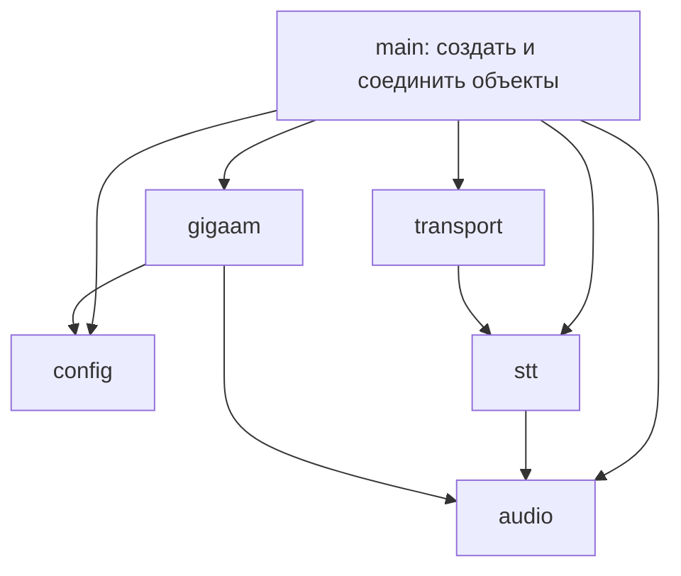

# 1. Устройство проекта и конструкции Go

[К содержанию](README.md) · [Следующая глава](02-startup-and-config.md)

## Пакет, модуль и программа

В `go.mod` записано:

```gomod
module vks-stt-v2

go 1.25.1
```

Модуль — набор пакетов с общими зависимостями. Директива `go` задаёт требуемую
минимальную версию Go. Поэтому пакет
сервисной логики импортируется как `vks-stt-v2/internal/stt`.

Пакет соответствует каталогу. Файлы `main.go`, `grpc.go` и `websocket.go`
из `cmd/stt-server` принадлежат одному пакету `main`. Их функции видны друг другу
без импорта. Имя файла `grpc.go` само по себе не создаёт пакет `grpc`.

Исполняемая программа начинается с `func main()` в пакете `main`.
Остальные пакеты предоставляют типы и функции. Каталог `cmd` здесь служит
соглашением об организации проекта; особую семантику для компилятора имеет
именно `package main`.

Каталог `internal` имеет специальное ограничение Go: его пакеты нельзя свободно
импортировать из постороннего дерева исходников. Это позволяет менять внутреннюю
структуру сервера без обещания публичной библиотеки для внешних пользователей.

Альтернатива — поместить всё в пакет `main`. Для маленькой утилиты это допустимо.
Здесь разделение полезно: сетевые протоколы можно тестировать без настоящей
нейросети, а обработку звука — без TCP-сервера.

## Зависимости направлены к общей логике

Сетевой код вызывает `stt.Session`. Сессия знает, какие действия ей нужны,
но не выбирает конкретные FFmpeg и GigaAM. Их создаёт `main`.



Это не строгая многоуровневая архитектура по учебнику: например, `stt` использует
типы `audio.Chunk` и `audio.Filter`. Разделение достаточно практичное:
протокол не управляет весами, а модель не разбирает JSON.

## Структуры хранят данные

Пример из `audio.go`:

```go
type Chunk struct {
    PCM   []byte
    Ended bool
}
```

`PCM` — сохранённые отсчёты звука, `Ended` — признак окончания речевого участка
по результату обработки. Это не класс с обязательным наследованием.
К структуре можно объявить методы, а можно передавать её как простое значение.

Составной литерал создаёт значение и заполняет указанные поля:

```go
chunk := audio.Chunk{PCM: pcm, Ended: true}
```

Остальные поля получают нулевые значения. У `bool` это `false`, у `int` — `0`,
у среза, указателя и интерфейса — `nil`. Поэтому `audio.Chunk{}` — корректный
пустой результат, но `config.Config{}` не является корректной конфигурацией:
обязательные ограничения проверяются отдельно.

Большая буква открывает имя для других пакетов: `Chunk`, `PCM`, `NewSession`.
Имена `streamFilter`, `pending`, `recognizeWindow` доступны только внутри пакета.

## Значение и указатель

В проекте встречаются оба вида получателя метода:

```go
func (p Processor) Decode(ctx context.Context, data []byte) ([]byte, error)
```

```go
func (s *Session) Close()
```

Первый метод получает копию структуры `Processor`. Она содержит настройки,
и `Decode` не должен менять их при каждом запросе.
Второй получает указатель на существующую сессию: её буфер, фильтр и последняя
гипотеза должны действительно измениться, а не измениться в копии.

`&value` — получить адрес значения, `*pointer` в выражении — прочитать значение
по адресу. В объявлении `*Session` означает тип указателя.
Для обычного доступа к полям Go сам разыменовывает указатель: пишут
`s.pending`, а не `(*s).pending`.

Указатель не означает, что программист обязан вызвать `free`. Память Go управляется
сборщиком мусора. Однако это не распространяется автоматически на объекты C++
в sherpa-onnx: для них в коде есть явные `Delete...`.

## Почему `[]byte` требует внимания к памяти

Срез содержит описание участка массива: адрес, длину и вместимость.
Присваивание среза не копирует сам звук.

Учебный пример:

```go
data := []byte{1, 2, 3}
view := data[1:]
view[0] = 9
fmt.Println(data) // [1 9 3]
```

Поэтому в `Buffer.retainOverlap` используется:

```go
b.pcm = append([]byte(nil), b.pcm[len(b.pcm)-keep:]...)
```

Здесь создаётся отдельная копия хвоста. Если ограничиться выражением
`b.pcm = b.pcm[len(b.pcm)-keep:]`, короткий хвост продолжит удерживать старый массив,
а последующий `append` может затронуть область, на которую ссылается старое окно.
Копия помогает безопасно вернуть прежний `sealed` для распознавания.

`append` иногда использует прежний массив, а иногда выделяет новый. Код не должен
строить корректность на предположении, что всегда произойдёт один из вариантов.
`...` после среза разворачивает его элементы в аргументы `append`.

`len(pcm)` измеряет байты, а не секунды и не число слов. Для PCM16 mono
при 16 кГц одна секунда равна `16000 * 2 = 32000` байт.

## Интерфейс описывает нужное действие

В `stt/session.go` объявлено:

```go
type Decoder interface {
    Decode(context.Context, []byte) ([]byte, error)
}
```

Любой тип с таким методом подходит автоматически. Строка `implements Decoder`
в Go не нужна. `audio.Processor` удовлетворяет интерфейсу, потому что у него есть
нужный метод с точно такой сигнатурой.

В тестах ту же роль выполняет простой тип:

```go
type fakeDecoder struct{}

func (fakeDecoder) Decode(ctx context.Context, data []byte) ([]byte, error) {
    if string(data) == "bad" {
        return nil, audio.ErrAudio
    }
    return append([]byte(nil), data...), ctx.Err()
}
```

Теперь сессию можно проверить без FFmpeg. Такой объект заменяет тяжёлую зависимость
в конкретном тесте; он не пытается имитировать весь аудиодекодер.

Интерфейсы объявлены в пакете, который ими пользуется. Это ограничивает контракт
тем, что действительно нужно сессии. Альтернатива — передавать `*gigaam.Model`
напрямую. Тогда тесты сессии оказались бы привязаны к конкретной реализации модели.

При этом интерфейс не нужен для каждой структуры. `Buffer` используется напрямую:
в коде нет нескольких взаимозаменяемых реализаций буфера и нет необходимости
подменять каждое его действие отдельно.

## Ошибка — обычное возвращаемое значение

Сигнатура:

```go
func FromEnv() (Config, error)
```

означает два результата: конфигурацию и ошибку. Принятый порядок проверки:

```go
cfg, err := config.FromEnv()
if err != nil {
    return err
}
```

Неуспешное действие обычно не вызывает `panic`. Неправильный аудиофайл и
истёкший срок запроса — ожидаемые ситуации, которые нужно вернуть клиенту.

Общие ошибки `audio.ErrAudio` и `audio.ErrLimit` создаются один раз через
`errors.New`. Их можно обернуть, сохранив возможность распознавания:

```go
return nil, fmt.Errorf("%w: ffmpeg: %s (%v)", ErrAudio, stderr.String(), err)
```

`%w` связывает внешнюю ошибку с `ErrAudio`. Поэтому транспорт использует
`errors.Is(err, audio.ErrAudio)`, а не сравнивает текст сообщения.
`%v` в конце выводит сообщение об ошибке процесса, но не добавляет её в цепочку
обёрнутых ошибок. Это намеренное различие в возможностях формата.

## `defer` связывает получение и освобождение ресурса

```go
ctx, cancel := context.WithTimeout(ctx, s.service.Timeout)
defer cancel()
```

Отложенный вызов выполнится при выходе из окружающей функции, в том числе
при раннем `return`. В одном вызове функции несколько `defer` выполняются
в обратном порядке постановки.

В проекте так возвращают распознаватель в пул, освобождают VAD, закрывают listener,
снимают блокировку и останавливают таймер. Это уменьшает число ветвей, в которых
ресурс можно забыть освободить.

`defer` не делает выполнение асинхронным. И он не гарантирует освобождение ресурса
при аварийном завершении нативного процесса или немедленном `os.Exit`.

## Указатель на строку хранит признак присутствия

```go
type Result struct {
    Partial *string `json:"partial,omitempty"`
    Message *string `json:"message,omitempty"`
}
```

Здесь различаются три ситуации:

| Значение | JSON | Смысл |
|---|---|---|
| `Message == nil` | Поле отсутствует | Ответ не содержит финального поля |
| `Message` указывает на `""` | `"message":""` | Поле есть, но текст пустой |
| `Message` указывает на текст | `"message":"текст"` | Есть финальный текст |

`omitempty` относится к указателю: непустой указатель на пустую строку не исчезает.
Обычная `string` с `omitempty` не позволила бы отличить первые две ситуации.

Адрес локальной строки можно безопасно вернуть:

```go
empty := ""
return Result{Message: &empty}, nil
```

Компилятор и сборщик мусора обеспечат необходимое время жизни значения.
Это не указатель на уже уничтоженную локальную переменную, как в ошибочном C-коде.

## Замыкание возвращает действие

`Session.acquire` возвращает `(func(), error)`: функцию освобождения места
и возможную ошибку. Функция помнит ссылку на нужный канал:

```go
return func() { <-s.service.Slots }, nil
```

Такой приём называется замыканием. Вызывающая сторона не знает деталей канала:
она получает `release` и сразу ставит `defer release()`.
Механизм подробно разобран в [главе 4](04-sessions-and-concurrency.md).

## Где появляются горутины

Ключевое слово `go` запускает функцию в отдельной горутине. В проекте это, например,
цикл сервера и отправка WebSocket ping. Обычные вызовы `Decode`, `Accept`,
`recognizeWindow` сами по себе не создают горутину и выполняются последовательно.

Горутина — управляемая средой Go единица выполнения. Это не отдельный контейнер,
не отдельный процесс и не обязательно отдельный поток ОС. Нативные вычислительные
потоки ONNX Runtime управляются другой библиотекой.

**Главный принцип чтения следующего кода:** сначала выясните владельца изменяемых
данных, затем — кто и в каком порядке вызывает методы этого владельца.
