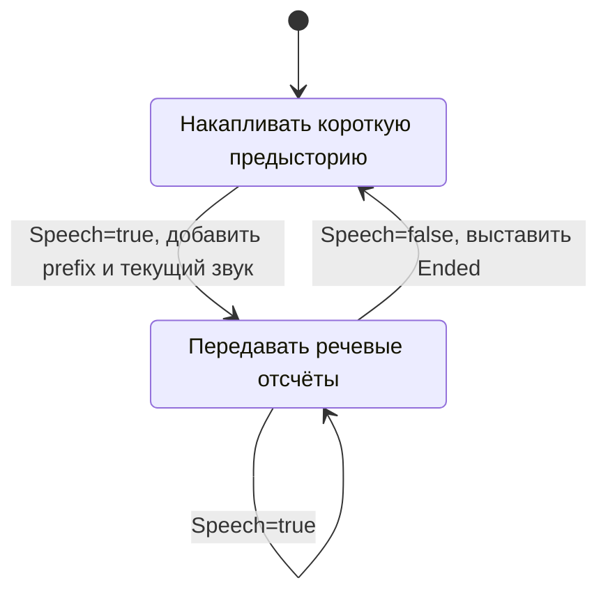

# 3. Декодирование звука и Silero VAD

[К содержанию](README.md) · [Предыдущая глава](02-startup-and-config.md) · [Следующая глава](04-sessions-and-concurrency.md)

Исходники: [`audio.go`](../../internal/audio/audio.go),
[`decode.go`](../../internal/audio/decode.go),
[`limit.go`](../../internal/audio/limit.go),
[`vad.go`](../../internal/audio/vad.go).

## Какие данные получает эта часть программы

В сетевом запросе приходит `[]byte` с самостоятельной записью: например, WAV
или Ogg/Opus. Код не предполагает, что это уже сырой PCM.
Каждая загрузка отдельно передаётся новому процессу FFmpeg.

Отсюда важное ограничение: нельзя просто разрезать произвольный MP3 или MP4
на куски по 4096 байт и считать каждый кусок независимой записью. Куску могут
потребоваться заголовок, таблицы контейнера и предыдущие пакеты кодека.
Для потоковой загрузки нужны самостоятельно декодируемые сегменты, например
отдельные WAV-записи. Само длительное сетевое соединение этого не исправляет.

После FFmpeg все последующие части получают один формат:

| Свойство | Значение |
|---|---|
| Каналы | Один, mono |
| Частота | 16 000 отсчётов в секунду |
| Один отсчёт | Знаковое целое из 16 бит |
| Порядок байтов | Little endian |
| Заголовок | Отсутствует, сырой PCM `s16le` |

Одна секунда занимает 32 000 байт, 25 секунд — 800 000 байт.
Размер исходного файла может быть гораздо меньше: сжатый кодек не хранит
по два байта на каждый исходный отсчёт.

## `Processor.Decode`: внешний процесс вместо своего аудиодекодера

Начало функции:

```go
if len(data) == 0 {
    return nil, nil
}
if len(data) > p.MaxBytes {
    return nil, ErrLimit
}
```

Пустая загрузка не запускает FFmpeg. Ограничение исходных байтов проверяется
до запуска процесса. Это другой предел, чем максимальная длительность звука.

Основные аргументы FFmpeg:

```text
-nostdin -hide_banner -loglevel error
-threads 1
-protocol_whitelist pipe
-i pipe:0
-vn
-f s16le -ac 1 -ar 16000 -acodec pcm_s16le
pipe:1
```

| Аргумент | Практический смысл |
|---|---|
| `-i pipe:0` | Читать аудиоданные из stdin процесса |
| `pipe:1` | Писать результат в stdout |
| `-nostdin` | Не читать интерактивные команды управления с stdin |
| `-protocol_whitelist pipe` | Не разрешать входу обращаться к другим протоколам |
| `-vn` | Не обрабатывать видеодорожку как видеовыход |
| `-ac 1`, `-ar 16000` | Свести каналы и частоту к контракту сервиса |
| `-f s16le`, `-acodec pcm_s16le` | Выдать PCM16 без WAV-заголовка |

`-threads 1` относится к FFmpeg, а не к ONNX Runtime. Это настройка декодера;
она не является общим ограничением числа всех потоков процесса Go.

В Go процесс создаётся через `exec.CommandContext`, а не через `sh -c`:

```go
cmd.Stdin = bytes.NewReader(data)
cmd.Stdout, cmd.Stderr = out, stderr
```

Значения передаются отдельными аргументами исполняемому файлу. Оболочка не разбирает
аудиоданные как команду. `bytes.NewReader` читает существующий срез и не требует
сначала записывать его во временный файл.

Контекст позволяет остановить FFmpeg при отмене или истечении срока запроса.
Это отличие от нативного `r.Decode`, который нельзя прервать этим способом.

### Почему не библиотека FFmpeg через CGO

Привязка к `libavcodec` могла бы убрать запуск отдельного процесса на каждый сегмент.
Но потребовала бы собственного кода управления форматами, пакетами, памятью
и совместимостью библиотек. Процесс FFmpeg уже решает эти задачи и изолирует
ошибки декодирования от адресного пространства Go-сервера.

Цена текущего решения — накладные расходы запуска процесса и копирования данных
через каналы ОС. Для очень коротких частых сегментов они могут быть заметны.
В проекте нет измерения, доказывающего, что этот способ быстрее библиотечной привязки.

## `limitedBuffer`: ограничение во время записи

Использовать обычный `bytes.Buffer`, а потом проверить его длину недостаточно:
к этому моменту процесс уже мог развернуть сжатое аудио в большой объём PCM.
Поэтому ограничивается сама операция записи в stdout.

Тип содержит:

```go
type limitedBuffer struct {
    buffer   bytes.Buffer
    max      int
    discard  bool
    exceeded bool
}
```

Метод `Write([]byte) (int, error)` делает тип совместимым с интерфейсом `io.Writer`.
Именно такой объект принимает `cmd.Stdout`.

Если свободно 10 байт, а FFmpeg передал 16:

1. В буфер попадают только первые 10.
2. Ставится `exceeded=true`.
3. Для PCM возвращается `ErrLimit` вместе с фактически записанным числом байтов.
4. Для stderr при `discard=true` лишние данные отбрасываются, но возвращается
   успешное принятие всех 16 байт.

Разница нужна потому, что переполнение диагностического вывода не должно само
ломать обработку процесса. Для stderr сохраняется не более 8192 байт.
Для PCM переполнение означает превышение длительности, а не «нормальный звук,
который разрешается незаметно обрезать».

После `cmd.Run` функция сначала проверяет отмену контекста, затем переполнение
stdout, затем остальные ошибки FFmpeg. Поэтому тип ошибки сохраняет смысл:
тайм-аут не превращается в «плохой аудиофайл».

Успешный результат дополнительно должен иметь чётное число байтов:
каждый PCM16-отсчёт состоит ровно из двух байтов.

## `Samples`: как байты превращаются в числа модели

Реализация:

```go
func Samples(pcm []byte) []float32 {
    samples := make([]float32, len(pcm)/2)
    for i := range samples {
        samples[i] = float32(int16(binary.LittleEndian.Uint16(pcm[i*2:]))) / 32768
    }
    return samples
}
```

Последовательность для одного отсчёта:

1. Прочитать два байта как little endian `uint16`.
2. Интерпретировать тот же 16-битный код как знаковый `int16`.
3. Преобразовать его в `float32`.
4. Разделить на 32768, получив нормализованную амплитуду.

| Байты | `int16` | `float32` после нормализации |
|---|---:|---:|
| `00 80` | −32768 | −1 |
| `00 00` | 0 | 0 |
| `ff 7f` | 32767 | Около 0,9999695 |

Это преобразование формата входа. Оно не вычисляет спектр и не выполняет
само распознавание. Акустические признаки для GigaAM далее рассчитывает sherpa.

Здесь выделяется новый массив `float32`. Использование `unsafe` не позволило бы
просто переинтерпретировать PCM16 как float32: числа имеют разный размер,
кодирование и масштаб. Явное преобразование одновременно понятно и корректно.

## Два уровня Silero

`Silero` хранит настройки и создаёт детекторы. `streamFilter` хранит изменяемое
состояние конкретного аудиопотока.

```go
type Filter interface {
    Accept(context.Context, []byte) (Chunk, error)
    Flush(context.Context) (Chunk, error)
    Close()
}
```

`NewSilero` проверяет файл и параметры, создаёт пробный поток, затем закрывает его.
Поэтому ошибка загрузки модели обнаруживается при запуске сервера.
Успешная проверка не оставляет один общий VAD для всех клиентов.

`NewStream` создаёт новый `sherpa.VoiceActivityDetector`:

- частота — 16 кГц;
- окно — 512 отсчётов, то есть 32 мс;
- один поток ONNX Runtime;
- вычисления на CPU даже в CUDA-образе;
- порог, padding и пауза окончания речи берутся из настроек.

Каждый активный буферизованный поток получает собственный детектор.
Здесь нет общего пула VAD, аналогичного пулу GigaAM.

### Почему нельзя разделить один VAD между клиентами

Silero использует историю обработки. Если передать ему попеременно звук клиентов
А и Б, состояние одной записи начнёт влиять на другую.
Один mutex вокруг общего VAD устранит одновременный доступ, но не смешивание истории.
Для изоляции нужны отдельные состояния, а не только блокировка.

## `speechDetector`: небольшой внутренний интерфейс

```go
type speechDetector interface {
    Speech([]float32) bool
    Reset()
    Close()
}
```

Реализация `sileroDetector` вызывает sherpa. В тестах `scriptedDetector` возвращает
заранее заданную последовательность `false, false, true, ...`.
Так можно проверить, сохранился ли первый и последний отсчёт фразы, без зависимости
от вероятностей настоящей нейросети.

После получения `IsSpeech()` обёртка вызывает `vad.Flush()` и `vad.Clear()`.
В данном использовании это очищает сборщик готовых сегментов sherpa: сами байты
PCM собирает Go-код. Сброс состояния модели выполняется отдельно через `Reset`.
Нельзя путать этот служебный `Flush` с `Session.Flush`, который завершает
обработку пользовательского потока и может запустить распознавание.

## Какие поля хранят состояние потока

| Поле | Что в нём лежит |
|---|---|
| `pending` | Отсчёты, из которых ещё нужно собрать полное окно из 512 отсчётов |
| `prefix` | Короткая предыстория перед обнаруженной речью |
| `active` | На предыдущем шаге детектор считал речь активной |
| `sent` | Сколько байтов неполного окна уже было отдано дальше |
| `padding` | Максимальный размер `prefix` в байтах |

`padding` вычисляется как `PaddingMS * 16000 / 1000 * 2`.
При 250 мс это 8000 байт.

## `Accept`: сетевой сегмент не равен окну VAD

Например, пришло 800 отсчётов. Первые 512 можно классифицировать сразу,
288 остаются в `pending`. Следующий запрос добавит к ним свои отсчёты.
Детектор не сбрасывается на границе сетевого сообщения.

Ключевой цикл:

```go
frame := f.pending[:windowBytes]
f.collect(&chunk, frame[f.sent:], f.detector.Speech(Samples(frame)))
f.pending = f.pending[windowBytes:]
f.sent = 0
```

В детектор уходит **полное** окно. В `collect` — только часть, которую ещё
не отдавали дальше. Эти аргументы намеренно различаются.

Если речь уже активна, остаток короче 32 мс отдаётся сразу:

```go
if f.active {
    chunk.PCM = append(chunk.PCM, f.pending[f.sent:]...)
    f.sent = len(f.pending)
}
```

Причина: текущая загрузка может оказаться последней перед фиксацией окна.
Без этого короткий хвост оставался бы ждать следующего запроса.
При следующем полном окне детектор всё ещё увидит эти отсчёты, но благодаря
`sent` модель распознавания не получит их повторно.

## `collect`: простой автомат состояния



Когда приходит `Speech=true`, Go-код сначала добавляет `prefix`, потом текущий звук.
Это возвращает начало фразы, которое появилось до уверенного решения детектора.

При `Speech=false` после активной речи ставится `Ended=true`.
Пауза окончания речи уже учитывается внутри настроенного Silero;
это не простая проверка «один тихий отсчёт — конец фразы».

`Chunk` содержит один общий признак `Ended`, а не список речевых границ.
Если внутри одной загрузки речь закончилась и снова началась, дальнейшее
`Speech=true` сбросит этот признак. Все обнаруженные фразы внутри загрузки
не превращаются автоматически в отдельные сетевые ответы.

## `Flush`: как не потерять неполный последний кадр

Последняя запись может закончиться на 123 отсчётах, когда детектору нужно 512.
Фильтр создаёт рабочее окно с нулями и копирует туда реальные отсчёты.
Затем подаёт ещё одно нулевое окно для решения детектора.

Однако в `collect` передаются только реальные байты:

```go
f.collect(&chunk, f.pending[f.sent:], f.detector.Speech(Samples(frame)))
f.collect(&chunk, nil, f.detector.Speech(make([]float32, vadWindowSamples)))
```

Нули помогают классификации, но не добавляются в звук для GigaAM.
В конце ставится `Ended=true`, а `defer f.reset()` очищает состояние фильтра.

Это не гарантирует обнаружение абсолютно любой короткой речи: решение всё равно
зависит от модели, порога и самого звука. Здесь обеспечивается корректная работа
с доступными отсчётами, а не обещается идеальная классификация.

## Закрытие и альтернативы

`Close` вызывает `sherpa.DeleteVoiceActivityDetector`. Это освобождение нативного
ресурса; одного исчезновения Go-ссылки недостаточно для своевременного закрытия.

Предыдущий подход с независимым VAD на каждый сегмент проще, но теряет историю
на сетевых границах. Текущий подход сохраняет состояние и требует аккуратного
`Flush` и `Close`. Замена Silero на другой VAD возможна через интерфейс, но новый
фильтр обязан соблюдать тот же контракт: PCM без искусственных отсчётов,
согласованная финализация и независимость клиентов.
