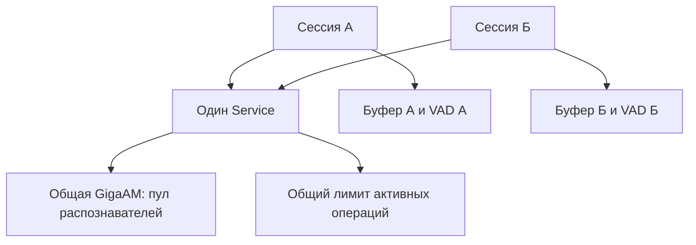

# 4. Сессии, буфер и ограничение нагрузки

[К содержанию](README.md) · [Предыдущая глава](03-audio-and-vad.md) · [Следующая глава](05-model-and-cgo.md)

Исходники: [`session.go`](../../internal/stt/session.go),
[`buffer.go`](../../internal/stt/buffer.go),
[`тесты сессий`](../../internal/stt/session_test.go).

## Общий сервис и отдельная сессия

У сервиса есть общие зависимости и настройки:

```go
type Service struct {
    Decoder    Decoder
    VAD        VAD
    Model      Model
    BufferSize int
    OverlapMS  int
    MaxSeconds int
    Timeout    time.Duration
    Slots      chan struct{}
}
```

У конкретного клиента — своё состояние:

```go
type Session struct {
    service *Service
    buffer  *Buffer
    filter  audio.Filter
    pending *string
}
```

`service` указывает на общий объект. `buffer`, `filter`, `pending` принадлежат
одной сессии. `pending` — последняя предварительная гипотеза текста,
а не необработанные байты звука. Для байтов есть другие буферы.



`NewSession` создаёт буфер, но не загружает VAD. Фильтр появляется при первой
буферизованной обработке через `ensureFilter`. Это отложенное создание:
подключение, которое не отправило звук, ещё не получает детектор.

## Контракты сервисной логики

```go
type Decoder interface {
    Decode(context.Context, []byte) ([]byte, error)
}

type VAD interface {
    NewStream() (audio.Filter, error)
}

type Model interface {
    Transcribe(context.Context, []byte) (string, error)
}
```

Сервису нужны три способности: декодировать запись, создать состояние детектора,
распознать PCM. Сервис не должен знать параметры `exec.Cmd`, C-структуры sherpa
или формат JSON-RPC.

Это позволяет тестировать порядок действий. Например, тестовая модель запоминает
все переданные массивы PCM: тест проверяет, что конец фразы не потерялся.

## Полный путь `Session.Transcribe`

Последовательность следующая:

1. Создать контекст с пределом `REQUEST_TIMEOUT`.
2. Получить разрешение на активную обработку через `acquire`.
3. Вызвать `Decoder.Decode`.
4. Для независимого запроса — выполнить `transcribeIndependent`.
5. Для буферизованного — получить фильтр и вызвать `filter.Accept`.
6. Передать речевой `Chunk` в `recognize`.
7. Вернуть `Result` или ошибку.
8. При выходе освободить разрешение и ресурсы таймера.

Создание контекста **до** ожидания разрешения означает, что очередь тоже входит
в срок запроса. Нельзя ждать очередь минуту, а затем получить ещё полную минуту
только на модель, если исходный срок уже истёк.
Если родительский контекст имеет более ранний срок, дочерний его не продлит.

Проверка декодирования предшествует изменению состояния VAD. Поэтому повреждённый
аудиофайл не уничтожает уже накопленную хорошую фразу. Это поведение проверяет
`TestInvalidAudioPreservesStateAndInferenceFailureReleasesIt`.

Ошибка `filter.Accept`, напротив, может возникнуть после изменения его внутренней
истории. Код закрывает сессию, чтобы не продолжать с частично изменённым состоянием.

## Независимый запрос не меняет текущую фразу

`transcribeIndependent` создаёт новый VAD, вызывает `Accept`, затем `Flush`,
соединяет полученные реальные отсчёты и один раз обращается к модели.
`defer filter.Close()` освобождает временный детектор.

Буфер и постоянный фильтр сессии не используются. Поэтому метод WebSocket
`upload_part_unbuffered` можно вызвать между буферизованными загрузками,
не смешав их историю.

«Независимый» здесь означает независимость состояния записи. Это не означает
обход ограничения нагрузки или отдельный экземпляр GigaAM.

## `Buffer` хранит звук, а не историю строк

Внутренние поля:

| Поле | Назначение |
|---|---|
| `pcm` | Накопленное окно реального PCM |
| `size` | После скольких добавлений окно нужно зафиксировать |
| `count` | Сколько добавлений произошло в текущем окне |
| `maxBytes` | Предел длительности окна в байтах |
| `overlap` | Сколько байтов конца сохранить для следующего окна |
| `committed` | Текущий текст окна уже зафиксирован |

`BUFFER_SIZE` считает вызовы `Add` с речевыми данными после VAD, а не секунды,
не слова и не все сетевые сообщения. Пустой `Chunk` до `Add` не доходит.

`Commit` только устанавливает флаг. Немедленного удаления PCM в нём нет.
Сохранение короткого хвоста происходит при следующем `Add`.

`Clear` удаляет всё окно и сбрасывает счётчик. Это другое действие.

## Пример: обычное накопление

Пусть `BUFFER_SIZE=4`, overlap=500 мс, а каждый речевой сегмент содержит секунду PCM.
Речь не заканчивается и предел 25 секунд не достигнут.

| Загрузка | PCM, переданный модели | Ответ |
|---|---:|---|
| А | 1 секунда | `partial` |
| Б | А+Б, 2 секунды | `partial` |
| В | А+Б+В, 3 секунды | `partial` |
| Г | А+Б+В+Г, 4 секунды | `message`, затем `Commit` |
| Д | Последние 0,5 секунды Г + Д | Новый `partial` |

Модель повторно распознаёт всё накопленное окно. `partial` — полная текущая
гипотеза, а не добавка к предыдущей строке. Клиенту обычно нужно заменять отображаемый
предварительный текст, а не безусловно склеивать все `partial`.

Это офлайн-модель, использованная в сервисе с потоковой доставкой сегментов.
Go-код не хранит скрытое состояние энкодера GigaAM между этими вызовами.

Альтернатива — распознавать только новый сегмент. Она сокращает повторную работу,
но уменьшает речевой контекст. Настоящая потоковая модель могла бы хранить
вычислительное состояние, однако это другая модель и другой контракт запуска.

## Перекрытие окон и отдельная копия хвоста

Формула из `retainOverlap`:

```go
keep := min(len(b.pcm), b.overlap, max(0, b.maxBytes-incoming))
b.pcm = append([]byte(nil), b.pcm[len(b.pcm)-keep:]...)
b.count = 0
b.committed = false
```

Нужно одновременно выполнить три ограничения:

1. Не сохранять больше байтов, чем есть в старом окне.
2. Не сохранять больше настроенного overlap.
3. Оставить место новому входящему звуку.

Если новая запись сама занимает весь лимит, overlap становится нулевым.
Новый звук важнее повторного контекста: он не должен исчезать ради хвоста старого окна.

Из-за перекрытия соседние финальные тексты могут содержать повторяющиеся слова.
В этой реализации нет отдельного алгоритма удаления текстовых повторов.
Нельзя удалять повторы простым сравнением одинаковых слов без учёта настоящей речи:
повтор может быть произнесён человеком намеренно.

## Предел длительности: что такое `sealed`

Пусть предел установлен в 1 секунду, overlap — 100 мс.
В буфере уже 0,75 секунды, пришло ещё 0,5 секунды.

Нельзя молча обрезать первые или последние 0,25 секунды. `Buffer.Add` возвращает
прежнее окно отдельным результатом `sealed`, сохраняет допустимый хвост
и добавляет новый PCM.

Учебный фрагмент с реальным API `Buffer`:

```go
b := stt.NewBuffer(64, 1, 100)
b.Add(make([]byte, 24000))
sealed := b.Add(make([]byte, 16000))

fmt.Println(len(sealed))     // 24000: прежние 0,75 секунды
fmt.Println(len(b.Sample())) // 19200: хвост 0,1 + новые 0,5 секунды
```

`recognizeWindow` сначала распознаёт `sealed`, потом новое окно. Если оба дают
текст, строки соединяются переводом строки. Это сохраняет звук, но не доказывает
идеальную текстовую стыковку на границе.

Копирование хвоста важно ещё и потому, что возвращённый `sealed` должен оставаться
неизменным, пока модель его читает.

## `recognizeWindow`: таблица решений

| Ситуация | Действие |
|---|---|
| PCM пустой, конец речи не обнаружен | Пустой `message`, без запуска модели |
| PCM пустой, конец речи обнаружен, есть `pending` | Вернуть его как `message`, очистить буфер |
| PCM есть, окно не полное, речь продолжается | Распознать окно, сохранить и вернуть `partial` |
| Окно полное | Вернуть `message`, отметить буфер как `committed` |
| Есть PCM и `Ended=true` | Вернуть `message`, полностью очистить окно |
| Возвращён `sealed` | Распознать оба окна и вернуть финальный результат |
| Модель вернула ошибку | Закрыть состояние сессии и вернуть ошибку |

Окончание речи очищает окно целиком. Поэтому контекст уже завершённой фразы
не переносится в следующую через overlap.

Пустой `message` сам по себе не сообщает причину: это может быть отсутствие
речевых данных без финализации. Интерпретировать его как «получено новое
завершённое предложение» нельзя.

## Почему `recognize` иногда делит один `Chunk`

Из-за предыстории VAD выход может оказаться чуть длиннее допустимого окна модели,
даже если загруженный файл прошёл проверку длительности.
`recognize` делит такой PCM на части размером не больше лимита и обрабатывает все части.

Здесь используется `min(len(chunk.PCM), limit)`, а не обрезание до первых 25 секунд.
Текст частей объединяется. Предположение о допустимой длине проверяется тестом:
ни один вход записывающей тестовой модели не должен превышать установленный предел.

## `Flush`: завершение потока

`Session.Flush` вызывается при gRPC `CloseSend` или явном JSON-RPC `flush`.
Он использует тот же тайм-аут и тот же общий лимит активной обработки.

Порядок:

1. Если фильтр ещё не создавался, вернуть отсутствие результата.
2. Вызвать `filter.Flush`, чтобы обработать отложенный конец звука.
3. Если появились новые реальные отсчёты, распознать окно заново с ними.
4. Если новых отсчётов нет, вернуть сохранённый `pending`, если он есть.
5. Через `defer s.Close()` освободить VAD и очистить состояние.

Возвращаемый тип — `(*Result, error)`. `nil, nil` означает «дополнительного ответа нет».
Это отличается от `&Result{Message: &empty}`: ответ есть, текст пустой.

После фиксации полного окна `pending` уже очищен, поэтому следующий `Flush`
не должен повторять его финальный ответ. После успешного завершения повторный
`Flush` тоже не выдаёт прежний текст.

`Close` не устанавливает флаг «сессия закрыта навсегда». Он очищает её состояние.
WebSocket-соединение после явного `flush` может начать новую фразу:
`ensureFilter` создаст новый фильтр при следующей буферизованной загрузке.

## Канал как ограничитель числа операций

Создание в `main`:

```go
Slots: make(chan struct{}, cfg.ModelWorkers*2)
```

`struct{}` — пустая структура. Значение не переносит полезные данные;
важно только число занятых ячеек канала.

В `acquire`:

```go
select {
case s.service.Slots <- struct{}{}:
    return func() { <-s.service.Slots }, nil
case <-ctx.Done():
    return nil, ctx.Err()
}
```

Отправка занимает место. Если канал заполнен, операция ждёт.
Получение из канала освобождает место. Возвращённая функция ставится в `defer`.
Вторая ветвь `select` позволяет выйти из ожидания по отмене.

Это счётный семафор, реализованный обычным каналом. Отдельный mutex не заменяет
его напрямую: mutex допускает одного владельца, а здесь нужен настраиваемый предел.

Если обе ветви готовы одновременно, `select` не гарантирует приоритет отмены.
Контекст также передаётся последующим операциям. Поэтому точный момент отмены
не следует интерпретировать как абсолютный запрет любого следующего шага.

`Slots == nil` явно отключает ограничитель. Это используется в простых тестовых
сервисах. Без этой проверки отправка в nil-канал ждала бы бесконечно.

## Чего именно достигает ограничитель

При `MODEL_WORKERS=1` одновременно внутрь обработчика допускаются две операции.
Одна может распознавать, другая декодировать или ждать экземпляр модели.
Слот удерживается до конца всего действия, включая ожидание модели.

Остальные запросы ожидают до истечения своего срока. Это ограничивает объём
активной работы, но не является жёстким пределом общего числа соединений,
ждущих горутин или уже существующих VAD-сессий.

## Почему у `Session` нет mutex

Один gRPC-stream обрабатывается последовательным циклом `Recv → Transcribe → Send`.
Одно WebSocket-соединение — последовательным циклом чтения и диспетчеризации.
Даже элементы JSON-RPC batch выполняются по очереди.

Поэтому в текущих транспортах методы одной сессии не вызываются одновременно.
Разные сессии работают независимо, а общие ресурсы защищаются на своём уровне.

Это условие использования, а не обещание потокобезопасности `Session`.
Если в будущем запускать обработку сообщений одной сессии в нескольких горутинах,
придётся обеспечить и взаимное исключение, и порядок аудио. Одного добавления
mutex может быть недостаточно, если записи начнут приходить в неправильном порядке.

## Почему нет отдельной очереди заданий и фоновых worker-горутин

Сетевые обработчики уже выполняются в горутинах. Они последовательно проходят
этапы и получают нужные разрешения. Дополнительная очередь потребовала бы хранить
задания, результаты, связь с контекстом и правила удаления отменённых задач.

Очередь полезна для асинхронных длительных заданий с идентификатором и повторными
попытками. Здесь контракт другой: клиент ждёт ответ на своё текущее аудио.
Текущий способ проще, но не предоставляет долговременного хранения заданий
или их восстановления после перезапуска процесса.
