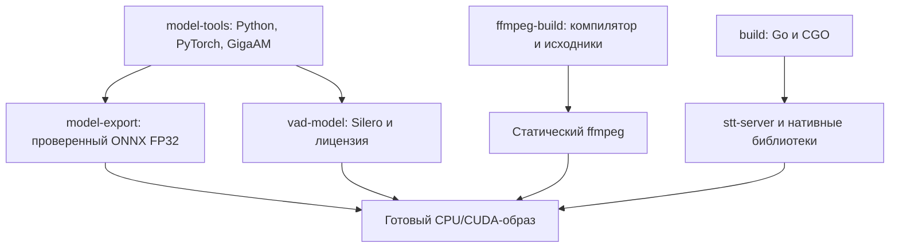

# 7. Сборка, подготовка моделей и тесты

[К содержанию](README.md) · [Предыдущая глава](06-transports.md) · [Следующая глава](08-patterns-and-changes.md)

Исходники: [`go.mod`](../../go.mod), [`Dockerfile.cpu`](../../Dockerfile.cpu),
[`Dockerfile.gpu`](../../Dockerfile.gpu), [`mise.toml`](../../mise.toml),
[`script`](../../script), [`tests`](../../tests).

## Почему готовый сервер не состоит из одного файла

Go может собирать многие программы в один исполняемый файл, но эта программа
вызывает C/C++ через CGO. Поэтому ей нужны совместимые нативные `.so`-библиотеки
sherpa-onnx и ONNX Runtime. Ещё нужны FFmpeg, ONNX-файлы и словарь.

Контейнер фиксирует совместную поставку этих компонентов.
Он не создаёт автоматически статическую линковку всех зависимостей.
Статическим здесь специально собирается FFmpeg; Go-сервер использует динамические
нативные библиотеки.

## Что фиксирует `go.mod`, а что — `go.sum`

В модуле явно перечислены основные зависимости:

| Зависимость | Назначение |
|---|---|
| `gorilla/websocket` | WebSocket-соединения и управляющие сообщения |
| `sherpa-onnx-go` | API нативного распознавателя и VAD |
| `grpc` | gRPC-сервер, клиент, status, health, reflection |
| `protobuf` | Типы сообщений и сериализация protobuf |

Зависимости с `// indirect` нужны через другие модули или инструменты.
Это не список заведомо неиспользуемых пакетов, которые можно удалить вручную.
Поддерживать граф зависимостей помогает `go mod tidy`.

`go.sum` хранит контрольные суммы модулей. Он помогает проверить содержимое
загружаемых модулей; сам по себе не является второй таблицей выбранных версий.

Раздел `tool` закрепляет инструменты генерации protobuf. Команда `go tool -n`
показывает путь к нужному инструменту с версией из модуля.
Это позволяет не полагаться на случайный `protoc-gen-go` в пользовательском PATH.
Сам `protoc` остаётся отдельной необходимой программой.

## Этапы сборки образа



Многоэтапная сборка переносит в последний этап только необходимые файлы.
Наличие Python, GCC и исходников в промежуточном этапе не означает, что они
попали в готовый образ через `COPY --from=...`.

Сборочные слои и кеш могут занимать много места у сборщика отдельно от
размера распространяемого готового образа.

## Сборка Go в `script/build-container.sh`

Скрипт выбирает каталог нативной библиотеки по целевым `GOOS/GOARCH`.
Предусмотрены Linux amd64 и arm64. Затем выполняет:

```sh
CGO_ENABLED=1 CGO_LDFLAGS="${CGO_LDFLAGS:-} -Wl,-rpath,\$ORIGIN/lib" \
  go build -trimpath -o /out/stt-server ./cmd/stt-server
```

- `CGO_ENABLED=1` включает связь с C-кодом.
- `-trimpath` убирает локальные пути сборочной машины из соответствующих записей бинарника.
- `rpath` задаёт поиск нативных библиотек относительно исполняемого файла.
- Экранированный `$ORIGIN` должен дойти до линковщика как специальное обозначение,
  а не быть подставлен shell как переменная сборочного окружения.

Скрипт копирует `.so` из закреплённого Go-модуля в `/out/lib`.
Последний этап переносит `/out` в `/app`. Там рядом оказываются
`/app/stt-server` и `/app/lib`.

## Что дополнительно делает CUDA-сборка

`script/install-cuda-libs.sh` проверяет, что версия Go API равна 1.13.8,
скачивает закреплённый архив нативных библиотек CUDA и проверяет SHA-256.
Архив содержит sherpa-onnx 1.13.8, ONNX Runtime 1.28.2 и CUDA provider.

CPU-библиотеки в `/out/lib` заменяются CUDA-набором. Идея — не держать рядом
две разные реализации под одним именем библиотеки и не рассчитывать на случайный
порядок поиска динамического загрузчика.

В готовом GPU-образе используется NVIDIA CUDA/cuDNN-основа. Для его сборки
сама GPU не требуется, но для запуска CUDA-режима нужны устройство и драйвер.

Go API и нативный ABI должны быть совместимы. Обновить только один из них,
оставив второй прежним, опаснее, чем обычное изменение чисто Go-зависимости:
несогласованные C-структуры и функции не всегда обнаруживаются компилятором Go.

## Экспорт GigaAM выполняется при сборке

`script/export-model-fp32.sh` запускается внутри `model-export`.
На хосте пользователя Python для этого не нужен.

Порядок работы:

1. Проверить, существует ли полный набор выходных файлов с `export.version=2`.
2. Создать временный каталог и зарегистрировать его удаление через shell `trap`.
3. Скачать exporter sherpa по закреплённому коммиту и проверить SHA-256.
4. Адаптировать его с помощью `prepare-model-fp32.py`.
5. Загрузить исходный checkpoint и tokenizer через GigaAM.
6. Выполнить экспорт и `validate-model-fp32.py`.
7. Скопировать проверенные файлы и лицензию в каталог модели.
8. Записать маркер версии последним.

Последний пункт нужен для повторного запуска после ошибки. Частично записанный
набор без маркера не должен считаться завершённым экспортом.
Это не полноценная транзакция файловой системы: каталог копируется несколькими
операциями. Маркер здесь служит признаком завершения для следующего запуска скрипта.

Checkpoint хранится в кеше сборщика `gigaam-v3-checkpoints`. Этот кеш не копируется
в готовый образ. Готовая модель находится в `/app/models/gigaam-v3-fp32`.

## Зачем адаптировать закреплённый exporter

`prepare-model-fp32.py` делает точные замены ожидаемых фрагментов.
Перед заменой проверяет, что каждый фрагмент встретился ровно один раз.
Затем разбирает полученный Python-код через `ast.parse`.

В числе изменений:

- загрузка модели на CPU с `fp16_encoder=False` и `.float().eval()`;
- удаление INT8-квантования;
- сохранение обычного `encoder.onnx`;
- явный batch size 1 для decoder и joiner;
- режим экспорта энкодера через `onnx_export_mode()`.

Смысл строгой проверки — не продолжать молча, если upstream изменился.
Альтернатива — поддерживать полную собственную копию экспортера. Это убирает
текстовые замены, но увеличивает объём кода, который нужно самостоятельно
сопровождать. Здесь выбран небольшой набор поправок к фиксированной версии.

## Почему исправление joiner важно

В исходном exporter пример входа joiner создавался с batch=8.
Без динамического batch он закреплялся в ONNX. Greedy-декодер sherpa подаёт:

```text
enc: [1, 768, 1]
dec: [1, 320, 1]
```

Поэтому ошибка `Got: 1 Expected: 8` относилась к joiner, даже если имя входа
`enc` похоже на название энкодера.

Исправление экспортирует joiner с batch=1. Делать его динамическим тоже возможно,
но текущий путь greedy-декодирования использует именно один кадр и не требует
произвольного batch в этом месте.

`validate-model-fp32.py` не ограничивается поиском текстового маркера:
проверяет имена, типы и формы входов, выполняет joiner на нулевых входах,
проверяет конечность значений и форму выхода `[1,1,1,1025]`.

Также скрипт отклоняет найденные квантованные операции и FP16/BF16-инициализаторы
в основных графах ONNX, затем создаёт `precision.json`.
Это конкретные проверки выбранного экспортера, а не универсальное доказательство
качества или семантической эквивалентности любой произвольной ONNX-модели.

## Загрузка Silero

`prepare-vad.sh` загружает модель v6.2.3 и лицензию из закреплённого тега,
проверяет SHA-256 обоих файлов. При уже правильных файлах повторно использует их.
Сначала загрузка идёт во временный каталог, затем файлы переносятся в итоговый.

У Silero не выполняется такой же экспорт из PyTorch: берётся готовый
закреплённый ONNX. В образ копируются модель и лицензия.

## Почему FFmpeg небольшой

`build-ffmpeg.sh` собирает закреплённый FFmpeg 8.1.3 со статической musl.
Сохраняются встроенные декодеры и демультиплексоры, но отключаются
сетевые протоколы и ненужные программы.
Выходные кодек и контейнер ограничены `pcm_s16le`, фильтры — нужными
для преобразования аудио.

`readelf` проверяет отсутствие динамического загрузчика у полученного бинарника.
В готовый образ переносятся бинарник и лицензии, а не компилятор и исходники.

Установить системный пакет FFmpeg проще. Такая установка обычно подтягивает
намного больше библиотек, чем требуется именно этому сервису.
Собственная сборка уменьшает готовый образ, но переносит на проект ответственность
за обновление закреплённой версии и проверку нужных входных форматов.

## Что делают Compose и mise

Базовый Compose выбирает CPU-образ, `.env`, порт, запуск без root
за счёт настроек образа, `init: true` и время остановки 15 секунд.
GPU-дополнение меняет образ и provider, передаёт устройство через NVIDIA CDI.

`mise run build:cpu` и `build:gpu` вызывают сборку Podman.
`run:cpu` и `run:gpu` сначала создают отсутствующий `.env`, затем вызывают
Compose с `up --no-build`.
То есть запуск не пересобирает незаметно образ. После изменения кода нужно
явно выполнить сборку.

Образы содержат модели. Внешнего mount `./models:/app/models` в штатном Compose
этой версии нет. Поверх готового каталога нельзя подключать пустой volume
и ожидать, что встроенные файлы останутся видны.

## Какие проверки есть у Go-кода

| Тесты | Проверяемое поведение |
|---|---|
| `internal/config/config_test.go` | Значения, диапазоны, provider/precision, некорректные числа |
| `internal/audio/audio_test.go` | PCM-нормализация, декодирование, пределы, отмена, восемь форматов |
| `internal/audio/vad_test.go` | Начало и конец речи, сетевые границы, неполное окно, искусственная тишина |
| `internal/stt/session_test.go` | Независимость клиентов, overlap, финализация, срок ожидания, ошибки |
| `internal/transport/transport_test.go` | Реальный сетевой контракт с тестовыми обработчиками |
| `internal/gigaam/model_test.go` | Проверка CUDA и необязательный настоящий инференс |
| `internal/stt/integration_test.go` | Необязательный полный путь FFmpeg → Silero → GigaAM |

### Тестовая замена модели

Из `session_test.go`:

```go
type recordingModel struct {
    inputs [][]byte
    err    error
}

func (m *recordingModel) Transcribe(_ context.Context, pcm []byte) (string, error) {
    m.inputs = append(m.inputs, append([]byte(nil), pcm...))
    return "Полный текст.", m.err
}
```

Она не распознаёт речь. Она копирует все полученные окна и возвращает известную
строку. Тест может проверить, что `Flush` передал `[старый PCM + хвост]`,
а не просто повторил старый текст.

Копия входа нужна и в тесте: сохранение одного среза без копирования могло бы
показать уже изменённый буфер вместо данных на момент вызова.
`_ context.Context` означает, что параметр нужен для сигнатуры интерфейса,
но эта тестовая реализация его не использует.

### Табличные тесты

В проверках JSON-RPC несколько входов перечислены рядом с ожидаемыми кодами ошибки.
Цикл запускает один и тот же разбор. Это удобно, когда действие одно,
а набор граничных случаев большой.

`t.Run` создаёт именованный подтест, `t.Setenv` временно меняет окружение,
`t.Cleanup` регистрирует очистку после теста. Тестам, меняющим окружение,
не следует бездумно добавлять параллельный запуск через `t.Parallel`.

### Проверка gRPC без настоящего TCP-порта

`bufconn` создаёт соединение в памяти, но через настоящие gRPC-обработчики
и сериализацию protobuf. Модель и декодер заменены простыми типами.
Проверяются имена методов, наличие полей, ошибки и финальный ответ после `CloseSend`.

Это больше, чем прямой вызов метода `GRPC`: проверяется передаваемый контракт.
Но это меньше, чем проверка контейнера с настоящими весами.

### Проверка WebSocket

`httptest.NewServer` поднимает временный HTTP-сервер,
`websocket.DefaultDialer` создаёт настоящие WebSocket-соединения.
Два клиента отправляют первый сегмент и должны оба получить собственный `partial`.
Так ловится случай, когда состояние случайно сделали общим.

## Необязательные проверки настоящих моделей

Тесты ничего не скачивают сами:

- `MODEL_TEST_AUDIO` включает проверку настоящей GigaAM; пути весов берутся из конфигурации.
- `VAD_TEST_MODEL` включает реальный Silero; `VAD_TEST_AUDIO` добавляет речевую запись.
- `TestRealChunkedPipeline` требует и `MODEL_TEST_AUDIO`, и `VAD_TEST_MODEL`.
- `MODEL_TEST_EXPECT` задаёт проверяемый текст или фрагменты в соответствии
  с конкретным тестом: у полного конвейера это список через запятую.

Без этих значений соответствующие тесты получают `Skip`.
Поэтому успешный `go test ./...` сам по себе не означает проверку настоящего
FP32-распознавания на пользовательской записи.

У FFmpeg-тестов тоже есть условие: если `ffmpeg` не найден в PATH,
соответствующая проверка пропускается. Для содержательной проверки декодера
важно смотреть не только итог `PASS`, но и список пропусков.

## Как запускать проверки

В Linux-среде с Go, C-компилятором, совместимыми нативными библиотеками и FFmpeg:

```sh
CGO_ENABLED=1 go test ./...
CGO_ENABLED=1 go test -race ./...
go vet ./...
```

Это команды разработки. Наличие Go и C-зависимостей для компиляции в готовом образе
не предполагается: для них нужна сборочная среда.
Race detector полезен для конкурентного Go-кода, но не является полной проверкой
внутренних гонок сторонней C++-библиотеки и не доказывает качество модели.

Регрессия экспортера выполняется в `model-tools` без исходного checkpoint:

```sh
podman build -f Dockerfile.cpu --target model-tools -t localhost/vks-stt-go:model-tools .
podman run --rm --network=none --userns=keep-id \
  --volume "$PWD:/src:ro,z" --entrypoint python3 \
  localhost/vks-stt-go:model-tools /src/tests/test_model_export.py -v
```

Тест использует настоящую архитектуру `RNNTJoint` со случайными весами.
Проверяет исправленный batch=1, воспроизведение ошибки batch=8,
совпадение ONNX/PyTorch в заданном допуске и отказ при неожиданном upstream.
Случайные веса подходят для проверки формы и численной реализации,
но не для оценки распознавания слов.

## Что нельзя вывести из имеющихся тестов

Нельзя автоматически заключить, что FP32 точнее всех вариантов на любом аудио,
что CUDA быстрее CPU на коротких запросах или что три контейнера утраивают скорость.
Для этого нужны одинаковые записи, эталонные расшифровки, прогрев, замеры времени
и памяти на целевом оборудовании.

История реально выполненных проверок и ограничения доступа к исходным весам
зафиксированы в [`docs/validation.md`](../validation.md).
Руководство объясняет эти границы, а не заменяет их новой неподтверждённой проверкой.
