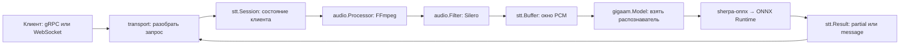

# Подробный разбор Go-проекта VKS STT

Руководство описывает код ветки **`main`**, коммит
[`bef31a3c21b25d6bf9c50b796bcc500f873375fb`](https://github.com/Pheodaron/stt/tree/bef31a3c21b25d6bf9c50b796bcc500f873375fb).
Это версия после переноса модели в образ и перехода на Silero VAD.
Во время подготовки руководства дерево файлов этого коммита совпадало с `work`.
Изменения, которые обсуждались, но не попали в этот коммит, здесь не описываются.

Задача руководства — объяснить не только последовательность вызовов, но и устройство
кода: что означают конструкции Go, кому принадлежат данные, где начинается
параллельное выполнение, зачем нужны интерфейсы и какие ограничения есть у решений.

## Порядок чтения

| Глава | Содержание |
|---|---|
| [1. Устройство проекта и язык Go](01-structure-and-go.md) | Пакеты, типы, методы, указатели, срезы, интерфейсы, ошибки и `defer` |
| [2. Запуск, настройки и остановка](02-startup-and-config.md) | `main`, сборка зависимостей, переменные окружения, сигналы, gRPC/HTTP-серверы |
| [3. Декодирование звука и Silero VAD](03-audio-and-vad.md) | FFmpeg, PCM, ограничения памяти, состояние детектора речи, неполные окна |
| [4. Сессии, буфер и ограничение нагрузки](04-sessions-and-concurrency.md) | `Service`, `Session`, `Buffer`, промежуточные ответы, финализация, каналы |
| [5. Модель, пул распознавателей и CGO](05-model-and-cgo.md) | sherpa-onnx, ONNX Runtime, `MODEL_WORKERS`, `NUM_THREADS`, блокировки, CUDA |
| [6. gRPC, protobuf, WebSocket и JSON-RPC](06-transports.md) | Сетевые контракты, сериализация, состояние соединения, примеры клиентов |
| [7. Сборка и тесты](07-build-and-tests.md) | Контейнеры, экспорт ONNX, зависимости, примеры тестовых замен, границы проверок |
| [8. Паттерны, альтернативы и изменения](08-patterns-and-changes.md) | Какие приёмы действительно применены, чем они полезны, где менять поведение |

Если задача — сначала понять обработку запроса, начните с главы 4, затем прочитайте
главы 3 и 5. Если изучаете Go на этом проекте, лучше читать по порядку.

## Что именно делает сервис

Приложение получает короткие записи или последовательность записей по сети.
Каждую запись FFmpeg переводит в единый формат звука. Silero выделяет речь.
Go-код собирает речевые отсчёты в окно и передаёт их модели GigaAM.
Полученный текст возвращается клиенту.

Важные разграничения:

- **Сетевой поток** — длительное соединение или gRPC-вызов с несколькими сообщениями.
- **Сессия** — Go-объект, который хранит состояние обработки конкретного потока.
- **Окно распознавания** — накопленные речевые отсчёты, передаваемые модели целиком.
- **Экземпляр модели** — загруженный распознаватель sherpa, используемый разными
  клиентами по очереди.
- **Поток ONNX Runtime** — вычислительный поток внутри нативной библиотеки.

Это разные сущности. Одно WebSocket-соединение не получает собственную GigaAM.
И параметр `NUM_THREADS` не задаёт число Go-горутин.

## Карта исходных файлов

| Место | Что находится внутри |
|---|---|
| [`cmd/stt-server/main.go`](../../cmd/stt-server/main.go) | Точка входа, создание зависимостей, сообщение о готовности |
| [`cmd/stt-server/grpc.go`](../../cmd/stt-server/grpc.go) | Запуск и остановка gRPC, health check и reflection |
| [`cmd/stt-server/websocket.go`](../../cmd/stt-server/websocket.go) | Запуск HTTP-сервера, `/healthz`, остановка WebSocket |
| [`internal/config/config.go`](../../internal/config/config.go) | Чтение и проверка настроек |
| [`internal/audio/audio.go`](../../internal/audio/audio.go) | Типы звука, общие ошибки, преобразование PCM в `float32` |
| [`internal/audio/decode.go`](../../internal/audio/decode.go) | Вызов FFmpeg |
| [`internal/audio/limit.go`](../../internal/audio/limit.go) | Ограниченный буфер вывода процесса |
| [`internal/audio/vad.go`](../../internal/audio/vad.go) | Silero и сохранение речевых границ между записями |
| [`internal/stt/session.go`](../../internal/stt/session.go) | Общий порядок обработки и состояние клиента |
| [`internal/stt/buffer.go`](../../internal/stt/buffer.go) | Накопление звука, ограничение длительности, перекрытие окон |
| [`internal/gigaam/model.go`](../../internal/gigaam/model.go) | Пул распознавателей, запуск и закрытие модели |
| [`internal/gigaam/provider_linux.go`](../../internal/gigaam/provider_linux.go) | Вызов проверки CUDA из Go через CGO |
| [`internal/gigaam/provider_linux.c`](../../internal/gigaam/provider_linux.c) | Проверка ONNX Runtime, NVIDIA-драйвера и устройства |
| [`internal/gigaam/provider_linux.h`](../../internal/gigaam/provider_linux.h) | Объявление C-функции проверки |
| [`internal/gigaam/provider_other.go`](../../internal/gigaam/provider_other.go) | Ответ на запрос CUDA вне Linux |
| [`internal/transport/grpc.go`](../../internal/transport/grpc.go) | Адаптация gRPC-запросов к сессии |
| [`internal/transport/websocket.go`](../../internal/transport/websocket.go) | Учёт соединений, чтение сообщений, ping/pong |
| [`internal/transport/jsonrpc.go`](../../internal/transport/jsonrpc.go) | Проверка JSON-RPC, вызов методов, формирование ответов |
| [`proto/stt/v1/stt.proto`](../../proto/stt/v1/stt.proto) | Исходное описание gRPC-контракта |
| [`gen/stt/v1/stt.pb.go`](../../gen/stt/v1/stt.pb.go) | Сгенерированные Go-типы protobuf |
| [`gen/stt/v1/stt_grpc.pb.go`](../../gen/stt/v1/stt_grpc.pb.go) | Сгенерированные gRPC-клиент и серверный интерфейс |
| `internal/*/*_test.go` | Проверки отдельных частей и связок между ними |
| [`tests/test_model_export.py`](../../tests/test_model_export.py) | Проверки экспортера на Python, вне серверного процесса |
| [`script/`](../../script) | Сборка сервера, FFmpeg, экспорт и проверка моделей |
| [`Dockerfile.cpu`](../../Dockerfile.cpu), [`Dockerfile.gpu`](../../Dockerfile.gpu) | Этапы сборки и состав готовых образов |
| [`compose.yaml`](../../compose.yaml), [`compose.gpu.yaml`](../../compose.gpu.yaml) | Параметры запуска контейнера |
| [`mise.toml`](../../mise.toml) | Короткие команды сборки, запуска и генерации protobuf |

`internal/gigaam/ort/onnxruntime_c_api.h` — заголовок сторонней библиотеки Microsoft,
а не написанная в проекте реализация ONNX Runtime. Объяснять его тысячи строк как
прикладной Go-код было бы неверно; в главе 5 разобрана та часть API, которую
действительно вызывает приложение.

## Как понимать объяснения причин

Фразы «код делает» описывают поведение, которое видно в исходниках и тестах.
Фразы «смысл решения» объясняют его технические последствия.
Сравнения с альтернативами — инженерный разбор, а не утверждение, что авторы
проводили сравнительное испытание всех вариантов.

Сокращённые фрагменты помечены как фрагменты. Учебные примеры не являются
добавленными функциями сервера. Числа длительности в примерах буфера относятся
к уже выделенному PCM; они не обещают такой же текст на произвольной записи.

Руководство описывает устройство программы. Проверку качества распознавания,
сравнение CPU/GPU и подтверждённые ограничения окружения нужно смотреть отдельно
в [документе о проверках](../validation.md).
